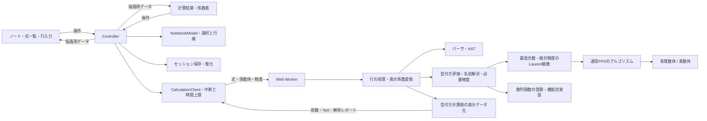

# FPS calculator 開発方針

## 最初に固定する意味

式は解析的関数の近似ではなく、係数体K上の形式冪級数と形式Laurent級数を表す。打ち切り次数Nは `f+O(x^N)` の絶対精度であり、多項式の次数上限や保持する係数の数とは区別する。通常FPSでは `K[[x]]/(x^N)` の精度に対応する。Laurent級数は最低次数mからN-1までを低次から格納する。xが可逆なK((x))で、(x^N)による商環と解釈しない。

`inv` は乗法逆元、`revert` は合成逆関数とする。log/expは通常FPSの定数項が1/0の場合を扱う。Laurent級数は四則演算・整数べき・微分・係数抽出・map、およびx^(-1)項が0の場合の積分に対応する。定数の一般的な対数・指数とPuiseux級数は現行の計算対象外とする。エラー時に浮動小数点やゼロ埋めへ暗黙に退避しない。

UIの基底切り替えは `c_n ↔ a_n=n!c_n` という同じFPSの表示である。入力係数列をOGF/EGFとして取り込む機能を追加する場合は、別操作で明示的に変換する。E.G.F.基底における積は二項係数を含む畳み込みになり、通常の係数列畳み込みと取り違えない。標数pでは階乗を割れない場合があるため、任意標数のdivided-power代数への拡張は別の設計課題とする。

## レイヤーと精度

責務の境界は実行時の依存にも反映する。Evaluatorと数列関数は共通の `language/values.ts` を使い、数列側は `SequenceRuntime` のコールバックだけで評価器を呼ぶ。`sequence-functions.ts` では登録表から候補名とハンドラを取り出し、`sequences/context.ts` へ引数の型・添字・要求精度を集約する。数列の数学は引き続きcoreに置く。

NotebookToolsは配置と通知、DocumentActionsViewはファイル/クリップボード操作、VariableRenameViewはフォームと候補、TemplateLibraryViewは分類・検索・選択・プレビューに分ける。JSON検証・ノート置換・名前変更の束縛検証・履歴はcontroller/appへ残す。InspectorViewはツールバーとコピーを扱い、ResultBodyViewが係数表・級数・解析・エラーを描画する。子ViewからWorkerや保存を直接開始しない。

CompletionMenuはCodeEditorが渡すIME状態を確認し、補完確定を従来のbeforeinput/inputイベントへ流す。候補のポップアップとviewportのイベントはCompletionMenu、ResizeObserverと色分けオーバーレイはCodeEditorが片付ける。行の破棄では両方をdestroyし、入力のDOM・選択・スクロールを保つ。

`main.ts` はスタイルの読込と `app/controller.ts` の起動だけを行う。状態の変更はcontrollerとNotebookModel、DOMの作成・更新は各View、非同期計算の管理はCalculationClientに分ける。フレームワークや新しいランタイム依存は追加しない。



| 場所 | 責務・依存の境界 |
| --- | --- |
| `model/calculation.ts` | UIとWorkerの入出力型、級数結果の型判定。DOMも評価器も参照しない |
| `config/limits.ts` | 行数・項数・文字数・精度・指数・サイズ・幅の共有上限 |
| `app/notebook-model.ts` | 追加削除・並べ替え・選択。DOMに触れず、現在の順序から次の選択を決める |
| `app/edit-history.ts` | undo/redoスタック、連続編集の集約、100操作の履歴上限。スナップショットの型は呼出し側が決める |
| `app/session.ts` / `notebook-document.ts` | ブラウザ保存・JSONの共通検証、許可した項目だけの復元。Storageは外から受け取る |
| `app/sharing.ts` / `rename-variable.ts` / `templates.ts` | URLの符号化・復元、束縛付き名前変更、空のサンプル集カタログ。DOMに依存しない |
| `app/calculation-client.ts` | Workerを所有し、デバウンス・世代番号・中断・旧応答破棄・重複応答破棄・時間上限を管理する |
| `app/controller.ts` | Viewの操作を受け、モデル変更・保存・計算要求・再描画を連携させる |
| `ui/components/` | ノート・式一覧・行入力・連立欄・結果ツールバー/本体の単位でDOMを所有する |
| `ui/components/notebook-tools.ts` | ツールの配置と通知欄。JSON/共有、名前変更、サンプル集の状態はそれぞれ子Viewが持つ |
| `ui/components/input-help.ts` | 静的な構文ガイド。ノートの状態や操作を持たない |
| `ui/interactions/code-editor.ts` / `completion-menu.ts` | 前者は色分け・括弧・エラー描画とIME表示、後者は補完候補のDOM・選択・確定 |
| `language/values.ts` / `expression-range.ts` | 評価器から独立した値型、ASTの原文範囲。数学の評価からエディタ支援への依存を避ける |
| `language/sequence-functions.ts` / `sequences/` | 数列関数の登録表、評価器とのコールバック境界、引数検証、多項式解析、演算別ハンドラ |
| `calculation/format-value.ts` | 計算済みValueをRowResultへ変換。OGF/EGF・TeX・解析の整形を所有し、名前解決や状態変更はしない |
| `ui/interactions/` | 入力カーソルと横スクロール、パネル幅、行ドラッグのブラウザ操作 |
| `ui/result-format.ts` | ラベル・プレビュー・コピー書式を生成するDOM非依存処理 |
| `ui/math.ts`, `ui/clipboard.ts` | KaTeXとクリップボードのブラウザAPI境界 |
| `styles/` | 基本・レイアウト・ノート・結果・レスポンシブの順でCSSを読み込む |

`workbook.ts` は公開計算APIを維持し、従来の型・MAX_ROWS/MAX_TERMSも再エクスポートする。新しいUIはmodelとconfigを参照し、計算実装を直接読み込まない。構文と評価の実装は従来どおりlanguage/coreに分ける。組み込み関数の名前・引数数・組合せ関数の別名は `language/builtins.ts` の定義をパーサと評価器で共有する。

セッションの保存形式は `version:1` のままにし、既存の式・行順・表示形式・入力幅を復元する。NotebookModelとsession、CalculationClientはDOMなしでテストできる。CalculationClientのWorker生成・デバウンス時間・時間上限は差し替えられるため、実ブラウザを起動せずに競合と中断を検証できる。

編集履歴はcontrollerが操作の直前にNotebookModelのスナップショットとViewから取得した入力位置を記録する。式の編集・行の追加/削除/複製/移動と計算設定を対象とし、選択・入力幅・結果の表示形式は独立させる。変更がなかった操作では履歴やredoを更新しない。同じ欄の1秒未満の連続入力は集約し、カーソル移動・フォーカス移動・貼り付け・IME変換で区切る。上限は100操作で、undo後の編集はredoを破棄する。

undo/redoでは行IDと選択を含む入力をコピーして復元し、session.inputの参照を維持して保存する。数式入力のカーソル・選択範囲・スクロール復元はExpressionListが所有し、復元中は選択イベントを再通知しない。計算に必要な内容が変わった場合はCalculationClientが古いWorkerを破棄して再計算し、行順だけの復元では結果をIDで再利用する。履歴自体は保存せず、再読み込み時は空から始める。

ボタンはNotebookView、Ctrl/Meta+Z・Shift+Z・Ctrl+YとネイティブのhistoryUndo/historyRedo入力は `ui/interactions/history-shortcuts.ts` が扱う。アプリ内の履歴とブラウザのテキストundoを二重に適用しない。IME変換中のキー操作は奪わず、Enterでも行を追加しない。

数式のIME変換は確定時に1回だけモデルと履歴へ反映する。変換中のDOM入力はWorkerの応答による再描画で上書きせず、変換中の時間経過によって履歴を分割しない。取り消した変換で内容が元に戻った場合は履歴やredoを変更しない。

1. `Field<T>` を通して演算し、有理数・modのアルゴリズムを共通化する。初期実装の `bigint` はmod乗算にも用い、JavaScriptの `number` で安全整数を超えた乗算をしない。
2. `LaurentSeries<T>` は絶対精度と最低次数を保持し、通常FPSのアルゴリズムには `Series<T>` を使用する。公開演算は新しい配列を返す。切り捨てはできるが、既に失った情報をゼロとして精度を増やさない。
3. パーサは手書きの再帰下降構文解析でASTを返す。組み込みの `eval` / `Function` は使わない。`language/evaluator.ts` で型付きの値を評価し、`workbook.ts` が行ごとの評価を集約し、`calculation/format-value.ts` が結果と表示係数を生成する。新しい関数は引数数・定義域・精度規則を伴って追加する。
4. 名前定義はワークブック全体から解決し、前方参照を認める。同名の複数定義はエラーとする。現在は評価スタックで循環経路を報告する。
5. 式の評価は「欲しい精度」を引数に取る。`diff(f)` のN項にはfのN+1項、`integral(f)` には通常N-1項が必要。名前参照も `(名前, 精度)` ごとにキャッシュし、表示用N項を微分して最高次を偽の0にしない。
6. AST・係数体・計算結果はDOMから独立させる。Workerには式と設定を渡し、厳密値を整形した文字列を返す。4秒の上限はUI側でWorkerをterminateすることで実装する。

初期実装は理解しやすい漸化式・素朴畳み込みを正解基準として残す。合成はHorner法、反転はLagrange反転公式を使う。有限体での分母が0になる場合は未定義としてエラーにする。現方式では標数により計算できない反転であっても、別の方式なら計算可能な場合があるため、将来は演算単位で必要条件を緩和できる。

## 型付きの式言語

組合せの予約語は `nCk` / `nPk` / `nHk` とし、関数記法と空白で区切った中置記法を持つ。単独のC/P/Hはユーザーの識別子として扱い、旧構文5C2等の字句分割は行わない。乗算の省略はパーサが通常の乗算ASTへ変換する。`2X` や `2F` の数値と識別子、隣接する括弧式に対応し、乗除算と同じ優先順位・左結合を保つ。識別子FGは分割せず、名前や呼出しの後の括弧は関数・ラムダの呼出しとして優先する。`2nCk(5,2)` は関数値への乗算、`5 nCk 2` は組合せ中置演算として区別する。

値はスカラー・級数・ラムダ・真偽値・解析レポートの直和型。漸化式の過去係数参照には内部history型を使う。級数は内部では共通のLaurent型で保持し、負の次数の有無でFPS/Laurentを表示する。`3` と `fps(3)` は区別する。混合四則演算はスカラーを定数FPSに昇格し、微積分もスカラーを定数FPSとして扱う。級数を整数や真偽値へ暗黙変換しない。`f[k]` / `coeff(f,k)` は通常係数のスカラーを返し、表示Nとは独立にmax(1,k+1)の精度を要求する。精度不足のラムダ引数などから未知の係数をゼロ埋めで取得しない。

スカラーは係数体上の値とmod前の厳密な有理数を持つ。通常の四則演算は両方に適用し、次数・添字・整数べき・階乗・組合せの引数と比較は厳密値を使う。mod2でも次数2を次数0と比較しない。FPSから抽出した有限体の係数は非負代表元を厳密値とする。階乗・組合せは整数上で計算してから写し、小さい標数で階乗の逆元を使わない。第1種スターリング数は符号なしで定義する。

`core/special-series.ts` にCatalanとLambertWの係数計算を置く。Catalanは整数係数の漸化式で生成し、単独の予約語で母関数、関数呼出しで定数項0のFPSとの合成を返す。LambertWは原点で0の枝の係数 `(-n)^(n-1)/n!` を厳密有理数で約分後に体へ写し、Horner法で合成する。入力の位数から必要な外側係数の次数を求め、不必要な分母の逆元を要求しない。係数抽出・微分・Laurent除算から要求された精度にも従う。負の次数や非零の定数項は拒否する。

`fps(n=>式)` は通常係数を生成する。ラムダは局所環境を捕捉し、名前付き呼出しとネストも可能。`map(f,n=>式)` は添字、`map(f,(a,n)=>式)` は現在の係数と添字を受け取る。従来の `map(f,a^2)` も維持する。mapで束縛するaには入力FPSへの係数アクセサも保持し、`a[n+1]` を元の入力式へ必要精度付きで問い合わせる。変換済みの係数は参照しない。明示的なラムダの局所束縛はmapの補助名より優先する。

条件は真偽値のみ受け付け、`?:` / `if` と `&&` / `||` は選ばれた枝だけを評価する。例えば次数0で `1/n` を回避できる。評価回数・深さ・精度・整数関数の引数・スカラーサイズに上限を設け、Workerの時間制限も維持する。

## Laurent級数と必要精度

非零級数fを `x^v U(x)`、`U(0)≠0` として扱う。除算と整数べきはxの因子を分離して、Uに対する既存の通常FPSアルゴリズムを使う。最低次数が負でも係数は有限個の負の項を持つ。負の項がすべて相殺されれば、最低格納次数を0へ戻して通常FPSとして表示する。

入力fの精度P、位数vに対し、逆元は一般に `O(x^(P-2v))` の精度になる。したがって出力Nには入力N+2vが必要。f/gの位数をa-bとすると、出力NにはfをN+b、gをN-a+2bまで要求する。積fgにはfをN-b、gをN-aまで、整数べきf^kにはfをN-(k-1)aまで要求する。現在の入力で足りなければ、ASTと名前参照を要求精度付きで再評価する。正の位数がある場合は既知の精度を余分に切り捨てない。

係数列が有限精度内で全て0の場合は、その精度まで零と分かるだけで、恒等的な零や位数∞と断定しない。分母・逆元では精度を倍増して最大512まで非零項を探す。見つからなければ「零級数または位数上限」と報告する。極の次数は128までとし、必要な入力の絶対精度にも512の上限を設ける。これらは計算資源の制限であり、数学的な零除算の判定と区別する。

Laurentの微分は次数を保って各係数へ整数次数を掛ける。積分のx^(-1)項が非零ならlog(x)が必要なため拒否する。有限体では他の次数の除算も検証する。負の次数を持つ級数のlog/exp・平方根・合成・合成逆関数は未対応として拒否する。一般FPS乗でも負の項のない底を要求し、指数の負次数との乗算では入力精度を調整する。

mapは入力の最低格納次数からN-1までを対象とし、それより下は変換しない。n/iは実際の整数次数であり、負になる場合もある。E.G.F.表示は負の階乗を定義しないため、負の項を持つ結果に対して拒否する。係数コピーはLaurentの場合のみ最低次数を持つJSONとし、通常FPSの配列形式を維持する。

## 平方根とべき乗

整数べきはスカラー式で指定でき、二分累乗を使う。一般の有理数乗とFPS乗は定数項1の底に対し `exp(g*log(f))` を使い、標数による除算条件を維持する。分母2の有理数べきは平方根と整数べきで計算するため、定数項が平方であれば1以外の底や偶数の正の位数にも対応する。一般の非単位FPSの高次根・Puiseux級数は対象外。

平方根は有理数体で整数の完全平方判定を使い、有限体はTonelli–Shanks法を使う。初期係数の根は有理数で非負、有限体では小さい代表元を選ぶ。FPSは先頭の位数が偶数である必要があり、標数2には未対応。位数2mの場合、出力N項には入力N+m項を要求する。N項で非零係数が見つからなければ2N項まで確認する。根の漸化式は2と先頭係数でのみ割るため、奇標数ではNがpを超えても計算可能な場合がある。

## 数式表示

`language/tex.ts` はASTと表示係数からTeX文字列を生成し、評価器やWorkerにDOM依存を持ち込まない。KaTeXはUIだけで利用し、`trust:false`・展開上限・大きさ上限を設定する。TeXを直接実行する入力欄ではない。入力文字列をHTMLへ差し込まず、TeXソースはtextContentで表示する。フォントもビルドに同梱し、実行時にCDNへ問い合わせない。

TeX生成は各子ASTを一度だけ走査する。子を事前にTeX化した後に括弧付け処理でも再走査すると、長い左結合式で指数時間になるため避ける。長い加算式でも係数計算とTeX生成を完了する回帰テストを置く。

係数表と横向き級数を切り替え、OGFでは負の次数を含むxべき、EGFでは非負次数のx^n/n!を描画する。最後には絶対精度のO(x^N)を付け、負の項の数だけO項の次数を増やさない。スカラーにはO項を付けない。

## 長い式の編集と並べ替え

`ui/interactions/resize-panel.ts` に入力パネルの幅調整、`input-scroll.ts` に入力行の横スクロール、`reorder-rows.ts` にPointer Eventsによる並べ替えを分ける。係数計算や式の意味は変更しない。幅はCSS変数でグリッドへ反映し、画面幅に応じた上限を設ける。保存する希望幅と、狭い画面へ収める実際の幅を分ける。境界のドラッグ・キーボードと拡大ボタンを提供し、スマートフォンは上下レイアウトにする。

各入力要素はCanvasの文字幅計測で式全体を収める幅にし、外側の行内コンテナへ横スクロールを持たせる。入力・カーソル移動時だけカーソルを可視範囲へ戻し、手動スクロールでは入力位置を変えない。グリッドと各列はmin-width:0を保ち、長い式でページ全体が横へ広がらないようにする。

行のドラッグは専用の取っ手から始め、式内の文字選択と分離する。挿入線を表示し、ドロップ時だけNotebookModelの行順を更新する。取っ手の上下キー・Home/Endにも対応する。タッチとマウスを同じPointer Eventsで扱い、端では一覧やページを自動スクロールし、Escapeやpointercancelでキャンセルする。

並べ替えでは行IDを維持し、ExpressionListがIDに対応するExpressionRowのDOMを再利用して必要な移動・追加削除だけを行う。選択中の行ID・入力の選択範囲・行内スクロール位置を維持し、行番号と操作ラベルを更新する。フォーカスを戻す間は選択イベントを再通知しない。削除時の位置は元の作成順を捕捉せず、NotebookModelが現在の行順から求める。係数結果は行IDで対応するため、並べ替えだけではWorkerを再起動しない。行順と希望幅を既存のバージョン付きlocalStorageへ保存する。

## 保存・共有・編集支援（実装済み）

`app/notebook-document.ts` がJSON入出力と既存version:1保存の共通検証を担当する。ポータブル形式は `{format:"fps-calculator",version:1,data,view}`。dataには行順・原文・initial・systems・計算設定を含め、IDs・幅・履歴は含めない。旧形式のformat省略も受け入れる。UTF-8で256 KiB、既存の行数・文字数・次数・連立欄上限を検証後に新規IDで復元する。式の数学的正当性やmodの素数性は通常の計算時に検証するため、編集中のノートも移動できる。ノートを部分的に上書きせず、controllerが検証済み内容を一括反映する。幅は受け手の設定を維持し、読み込みは表示形式を含め1回のundo対象とする。表示形式の単独変更は従来どおり履歴を増やさない。

`app/sharing.ts` は同じJSONをUTF-8/Base64urlでURLフラグメントに格納する。サーバー保存は行わず、12,000文字を超えるリンクはJSONへ案内する。復元成功後はfragmentを消して以後の編集と再読み込みを両立する。不正なリンクでは現在のノートを保持する。

`language/tokens.ts` の位置付き字句をパーサと色分けで共有する。ASTには宣言・symbol・整数・ラムダ引数の原文範囲を保持する。`SourceError` とWorker結果のdiagnosticはUTF-16の開始/終了オフセットを使い、ネイティブ入力の選択範囲と一致させる。`editor-analysis.ts` は構文診断・括弧対応・補完候補を純粋な処理として生成する。`ui/interactions/code-editor.ts` はネイティブinput/textareaを残し、テキストの色分け用オーバーレイと補完候補だけを重ねる。IME中は入力本体を表示し、補完確定はbeforeinput/input経由で既存の編集履歴へ流す。エラー位置ボタンで該当箇所を選択する。位置を特定できない連立エラー等は結果欄に残す。

`app/rename-variable.ts` は全欄を構文解析してから、グローバルな宣言と自由参照の原文範囲だけを後ろから置換する。ラムダ引数・mapのa/n/i・部分文字列を区別し、予約語・重複定義・局所名への捕獲・構文エラー・上限超過では全変更を拒否する。名前付きmapラムダに呼出し時に注入されるiが、グローバル名の変更で別の意味になる場合も拒否する（静的に確定できない間接変換は保守的に拒否）。原文書式と既存IDを保ち、初期値と連立未知数も扱う。一括変更は1回のundo対象とする。

`app/templates.ts` のカタログは空。`NotebookTemplate` のID・タイトル・説明・分野・documentを使い、組合せ論/漸化式/木/連立系で分類・検索・プレビュー・検証付き読み込みを行うUIだけを実装した。サンプル内容と既知係数の検証は未実装の別作業とする。将来のサンプルもコードとして実行せず同じノート検証器を通す。

## 数列・復元・微積分系（実装済み）

`core/sequences.ts` はField<T>だけを使い、線形漸化式、学習用の矩形線形系による候補推測、有理母関数の分子/分母、二項変換、p-recursive生成、微分作用素への変換を担当する。`language/sequence-functions.ts` が数列関数の登録を担当し、`sequences/recurrences.ts`・`analysis.ts`・`transforms.ts`へ委譲する。共通の型/精度検証はcontext.ts、係数多項式の抽出はpolynomial.tsへ分ける。関数の引数数はbuiltins.tsで集約し、seq等の可変引数も同じ検証器を通す。

recurrenceの履歴は通常スカラーとは別の内部値型historyを使う。a[k]で確定済みの過去係数だけを返し、未来・負添字・履歴自体の四則演算は拒否する。添字nはmod前の厳密整数。seqは既知の入力個数を保持し、guessで列挙後のゼロを勝手に検証データへ加えない。通常FPSの推測では要求されたN項を使う。

guessは低次数から学習データだけで候補を求め、一意性をrankで確認する。残りの項は次数選択・フィットに使わず、検証の成否と最初の不一致を表示する。解析値はanalysis型とし、係数体・説明行・再利用できる式をWorker経由で返す。レポートはtextContent、式のTeXは生成式をASTへ戻した結果から描画する。有限精度比較や推測を恒等性の証明と表示しない。

定係数漸化式 `a_n=Σ_(j=1)^r c_j a_(n-j)` は `Q=1-Σ c_j x^j`、`P=[Q Σ_(n<r) a_n x^n]_(<r)` からF=P/Qを厳密に復元する。p-recursiveは `Σ_(j=0)^r p_j(n)a_(n+j)=0 (n≥0)` とし、theta=xDを使って

```text
L = Σ_j x^(r-j) p_j(theta-j)
B = Σ_j x^(r-j) Σ_(m<j) p_j(m-j) a_m x^m
L F = B
```

を構成する。theta^k=Σ_l S(k,l)x^l D^lで通常の微分作用素へ展開し、境界項Bを落とさない。全係数に共通のx因子のみ除く。作用素の最小性・正則性は保証しない。一般の変換と初期境界条件の考え方は[gfun rectodiffeqの資料](https://perso.ens-lyon.fr/bruno.salvy/data/rectodiffeq.pdf)も参照する。p-recursiveは8シフト・係数多項式8次、通常漸化式/推測は16階、seqは64項、既存の精度512・Workerの中断上限を保つ。

微積分系は`differential-normalize.ts`で積・商・連鎖律を展開し、未知関数の微分次数を解析する。`implicit-expression.ts`は代数系と微積分系で式コンパイルを共有するが、後者のderivativesは点ごとの偏微分ではなく、現在求める係数方向のFrechet微分とする。微分・積分は値と方向微分の両方へ作用させ、各子式の必要精度を調整する。精度1の積分は子式を評価せずゼロとする。

`core/differential-system.ts`が係数の確定順序と線形系を管理する。未知関数iの最大微分次数r_iに対し、出力次数nでa_(i,n+r_i)を求める。低次の初期係数をscalar/seqで受け取り、欠けた定数項はアフィン制約だけで推定する。最高階の定数係数はアフィンであることを検証し、必要ならその係数も初期値として与える。非線形な根を勝手に選択しない。

要求精度で確定できる係数だけを未知列とし、各方程式が参照する微分次数から、検証可能な行だけをその次数の線形系へ含める。これにより、mod pでN=pの有効なODEのprefixを、不要なa_pを求めて拒否しない。精度の延長時は各方程式の検証済み次数から再開し、実際の残差検証後だけキャッシュを更新する。外側のdiffやextractの追加精度も同じ経路を使う。

微積分系は解法選択によらずdifferential-coefficientとして表示する。旧ImplicitSystemの点ごとのNewton法は代数系に残す。特異な最高階行列、高指数DAE、未知関数の合成・map・係数抽出、Laurent/Puiseux解は依然未対応で、特異性を解なしと断定しない。8階微分、結合後8未知数、4グループ、4096文字/欄、512文字/式、内部精度512を維持する。

## 今後の実装計画

この節は元の開発順序と残りの実装予定を記録する。JSON入出力・編集支援・一括名前変更・URL共有・サンプル集の外枠は上記のとおり実装済み。数列・漸化式・推測/比較・有理母関数と微分方程式の復元・正則な微積分系も実装済み。サンプル内容・高速化・合成等の拡張は未実装。実装済みの基盤は、厳密な単変数FPS/Laurent演算、型付き式・ラムダ/map・TeX、循環定義と正則連立方程式、Worker、表示切り替え、複製・undo/redo、幅調整・行の並べ替え、ブラウザ保存である。既存のmapで記述できる変換と、実装済みの専用演算は区別する。

編集・保存・共有を先に充実させ、その後に競技プログラミング向けの数列操作、計算範囲と速度を広げる。実装規模は現時点の概算とし、公開日や具体的な計算上限はまだ定めない。現在の構文・保存形式・定義域・精度制限は、各機能を実装して検証するまで維持する。

### 機能一覧と優先度

| 優先度 | 実装予定 | 目的・範囲 | 規模の目安 |
| --- | --- | --- | --- |
| 完了 | JSONによる保存・読み込み | ノートのバックアップ、別端末への移動、問題別の管理 | 小〜中 |
| 完了 | 入力補完・構文ハイライト | 関数名・定義済み変数の補完、括弧の対応、エラー箇所の下線表示 | 中 |
| 完了 | URLによる共有 | 式・係数体・次数・連立設定をまとめて共有。長いノートはJSONを利用 | 中 |
| 完了 | 変数名の一括変更 | 定義と参照先をまとめて更新し、複製後の編集を簡単にする | 中 |
| 完了 | 計算結果の比較 | 指定精度までの一致と、最初に異なる係数・次数を表示 | 小〜中 |
| 完了 | 漸化式からの級数生成 | 初期値と漸化式から係数を生成し、定係数線形漸化式では有理母関数も表示 | 中 |
| 完了 | 数列からの推測 | 先頭数項から線形漸化式・有理母関数の候補を提示 | 中〜大 |
| 完了 | 数列変換の専用演算 | 部分和、二項変換、Hadamard積、偶数・奇数項抽出などを簡潔に記述 | 小〜中 |
| 中（外枠完了） | サンプル集・テンプレート本体 | 組合せ論、漸化式、木の数え上げ、連立系などを用途別に用意 | 小 |
| 中 | 高速化と計算可能次数の拡大 | 素数modでのNTT、FPS基本演算の高速なNewton法、キャッシュ改善 | 大 |
| 完了（正則系） | 微分・積分方程式 | 初期値付きで級数解を求める。例: diff(f)=f、f(0)=1 | 大 |
| 将来 | 合成を含む関数方程式 | 例: f=1+x*compose(f,x^2) のような再帰を扱う | 大 |
| 将来 | 多変数 | 次数体系と項数制限を定め、多変数級数の表示・演算を追加 | 特大 |
| 将来 | 特異系・Laurent/Puiseux級数の解 | 現在の正則な通常FPSソルバーを超える方程式と枝に対応 | 特大 |

### 着手順序と完了基準

| 順序 | 主な内容 | 完了基準 |
| --- | --- | --- |
| 1（完了） | JSON保存・読み込み | 通常行・再帰初期値・連立設定・係数体・精度が往復でき、不正ファイルで既存ノートを壊さず、読み込みをundoできる |
| 2（完了） | 入力補完・エラー位置表示・括弧対応・ハイライト・変数名変更 | 長い式、IME、カーソル/選択、横スクロール、ラムダ束縛、既存のundo/redoを維持する |
| 3（共有・外枠完了） | URL共有・サンプル集 | 共有内容を同じ計算条件で再現でき、サンプルは既知の係数と一致する。URLが長い場合はJSONを使える |
| 4（完了） | 漸化式入力・数列の推測・結果比較・数列変換 | 既知の数列と照合し、有限精度の一致・推測・数学的な恒等性を混同しない |
| 5（微積分系完了） | 高速化と次数拡大、微分・積分方程式 | 速度改善は素朴実装との一致と計測で確認する。方程式は初期条件・必要精度・標数条件と残差を検証する |
| 6 | 合成を含む関数方程式、多変数、特異系・Laurent/Puiseux解 | 係数が決まる条件、枝・精度・次数の意味、未対応条件を明文化してから対応範囲を広げる |

同じ段階の項目も独立した変更に分け、利用者の依頼や依存関係に合わせて進める。段階5の速度改善と微分方程式対応は別の作業として検証する。連立暗黙方程式のNewton法は実装済みであり、ここで予定するFPS基本演算の高速化と混同しない。

### 保存・編集・共有の設計方針

- JSONはバージョン付きの形式とし、既存のversion:1のブラウザ保存と相互運用できるようにする。文字数・行数・未知数などを検証してから反映し、途中まで書き換えない。読み込み全体を1回のundo対象にする。
- URL共有はJSON入出力と共通のノート表現を使い、ブラウザだけで復元できる構成を基本とする。共有対象は式と計算設定・再帰初期値・連立設定を中心にし、履歴の永続化とは分けて設計する。長いURLの代わりにJSONへ切り替えられるようにする。
- エラー位置と補完にはパーサのトークン位置やASTを使い、入力欄と位置の基準を揃える。数式の実行にeval/Functionを使わない。補完確定や一括変更も履歴へ接続し、IME変換と既存のショートカットを妨げない。
- 変数名変更は単純な文字列置換にせず、名前の定義・自由変数・ラムダの局所束縛・連立の未知数宣言・初期値の参照を区別する。変更先の予約語や名前の重複を検証し、1回のundoで戻せるようにする。
- サンプルは外部スクリプトとして実行せず、ノートの式・設定と説明から構成する。係数体・精度・初期値を明示し、有理数と素数modの使用条件を検証する。

### 数列操作・比較・推測の設計方針

- 結果比較は係数体と精度を揃え、Laurent級数の負の次数も含めて最初の差を表示する。有限の係数一致を無限級数の恒等性の証明として表示しない。
- 漸化式入力は、まず定係数線形漸化式と必要な初期値から始める。添字、初期値不足、係数体上の可逆性、参照する次数を検証する。一般の非線形・可変係数漸化式へ広げる場合は対象を別に明記する。
- 数列からの推測は、線形漸化式や有理母関数の候補を出す機能とする。使用した項数・候補の次数・既知項への一致・推測に使っていない検証項への一致を示す。入力例への一致と数学的な証明を区別し、情報不足や非一意の候補を断定しない。
- 数列変換は通常係数に作用する規則と必要精度を定義する。偶数・奇数項抽出などで出力N項に追加の入力係数が必要なら要求を伝播する。OGF/EGFの表示基底切り替えの意味を暗黙に変更しない。

### 方程式の拡張と継続課題

微分・積分方程式では必要な初期係数と標数による分母条件を指定し、必要精度の伝播を設計する。合成を含む方程式では内側の定数項・位数と係数依存を調べ、次数順に係数を確定できる範囲から対応する。これらを現行の点ごとのJacobianへそのまま渡して解けるとは扱わない。特異系・Laurent/Puiseux解では、枝・位数・分数次数を含む精度表現を別途設計する。多変数と高速化の詳細は後述する。

既存の継続課題である履歴の永続化とブラウザE2EのCI化も維持する。現在のタブ内undo/redoやブラウザ保存を未実装扱いにせず、永続化する履歴の範囲・容量・形式は別途検討する。

## 循環参照と連立方程式

実装済み。`language/dependencies.ts` が自由変数を収集し、ラムダ呼出しを捕獲回避付きで展開する。非循環の名前は従来どおり評価し、強連結成分（SCC）を `implicit-workbook.ts` が一つの連立系へまとめる。明示グループの未知数は同じ成分へ束ね、通常定義と複数グループをまたぐ循環も結合する。未知数名の重複・予約語・個数・式の形式は先に検証する。

`implicit-expression.ts` は対応する式を「級数の値・未知数に関する偏微分」の計算へコンパイルする。独立した部分式は通常のEvaluatorを再利用する。整数べき・四則演算・単位の逆元・exp/log等を扱う。未知数を含む微分・積分は上記の係数方向ADへ切り替える。合成・map・係数抽出・再帰ラムダは点ごとのJacobianへ還元できないため拒否する。条件は未知数と独立な場合に選択した枝だけをコンパイルする。既存のxに関するdiffとは別の微分である。

定数項はアフィンな制約を抽出してGauss-Jordan法で解き、一意に定まる成分を順に補う。非線形の定数根を探索して勝手に枝を選ばない。通常行のinitial、または明示グループの `u = 1` のような宣言で枝を指定する。初期値は未知数から独立したスカラー式に限る。初期ベクトルcに対するF(0,c)=0とJ0=∂F/∂y(0,c)の可逆性を検証する。特異なJacobianを解なしとは断定しない。

`core/linear-algebra.ts` は係数体経由の線形代数、`core/implicit-system.ts` は3方式の求解を担当する。J0の逆行列は一度だけ計算して再利用する。

- 自動でJ0=Iなら `y ← y-F` を使う。対応演算の範囲で更新のx進位数が増えることが保証され、確定精度を1ずつ増やす。
- 係数逐次法は `[x^n]F` からJ0を用いて次の係数ベクトルを決める。
- 形式Newton法は `JΔ=-F, y←y+Δ` で精度を倍増する。級数行列の線形系を次数順に解き、明示的な級数行列逆行列は作らない。自動設定で非収縮の系は16項以上からNewton法へ切り替える。

反復用の近似には未知の高次項を一時的にゼロとして与えるが、確定した級数の精度をゼロ埋めで増やすこととは区別する。拡張のたびに既存の係数が変わらないこと、最後に残差がO(x^N)であることを検証してからキャッシュを更新する。キャッシュはSCC全体の解・初期値・係数体に対応し、workbookの再評価で破棄する。外側のdiff・係数抽出・Laurent除算による追加精度は、SCC全体を精緻化して返す。

通常行は再帰の初期値欄を持ち、一般等式はEquationSystemsViewで未知数・初期値・方程式・解法を編集する。結果は名前で通常の評価器から参照できる。Calculationのoptional systemsとInputRowのoptional initialをversion:1へ追加し、従来データとの互換性を維持する。スナップショットはグループも複製し、初期値・追加削除・編集・解法変更をundo/redoと保存へ接続する。Workerの世代番号による旧応答の拒否はグループ結果にも適用する。

4グループ、結合後を含め未知数8個、各欄4096文字、方程式1本512文字、内部精度512、既存の4秒上限を使う。素数体の多項式系には一律にN<pを要求せず、Jacobianと各演算の分母をその体で検証する。特異系、未知数に極がある系、Puiseux級数、合成等を含む関数方程式は後続課題とする。

## 高速化の順序

競技プログラミングでは998244353のNTTが有用だが、最初から汎用式評価と高速畳み込みを同時に複雑にしない。まず素朴版とランダムな小入力で照合できるようにし、演算数と有理数のビット長を測定する。

- 適合する素数ではNTTとNewton法を導入する。素数ごとに原始根・変換長上限を検証し、非対応modには素朴法の経路を残す。
- 数値精度を維持したmod乗算を使う。`number` への無条件変換は行わず、必要ならWASMを検討する。
- 有理数の分母増大には約分・交差約分・係数サイズの制限を検討する。NTT対応だけで有理数演算が高速化すると考えない。
- 大規模な合成・合成逆関数は乗算より高コストであり、単独で性能評価する。

## 多変数

単変数の密な配列へ無理に詰め込まず、`MultivariateSeries` を別型で作る。最初は `Map<monomialKey, coefficient>` の疎表現を候補とし、変数リストと指数ベクトルを持たせる。

先に「全次数がN未満」か「変数ごとの矩形精度」かを決定する。初期案は全次数N未満。d変数で保持し得る単項式の数は `binomial(N+d-1,d)` なので、Nだけでなく総項数も制限する。偏微分では必要な入力次数が増え、合成時には内側の各級数の定数項0が必要になる。E.G.F.表示は多重添字ごとの階乗積を用いる。

UIは係数表に単項式列とフィルタを加える。1変数の逆関数をそのまま多変数へ拡張せず、逆写像としてJacobianの条件を明示する。

## 検証とGit管理

実行環境はNode.js 24以上。`.nvmrc` とpackage.jsonのenginesだけでは古いNode.jsの使用を防げないため、npmスクリプトはNode.js 12でも読める `scripts/run.cjs` を入口とする。システムのNode.jsが要件未満なら `.local/node/bin/node` を検証して使い、見つからなければセットアップ手順を表示する。Viteの依存内で構文エラーが出る前に対処できるようにする。

Linux/macOS向けの `scripts/setup-node.sh` は公式配布をSHA-256検証し、無視対象の `.local/node/` に導入する。システム設定は変更しない。依存のインストールは対応するNode.jsのPATHで実施する。CIはsetup-nodeで24を導入するため、通常のシステムランタイム経路を使う。

既知の展開（幾何級数・exp/log・Catalan数）、`exp(log f)=f`、`f*inv(f)=1`、合成逆関数の左右両方向、微積分の恒等式を係数体ごとに検証する。小さい素数で割れないケース、N=1、微分後の最高次、前方参照、循環、重複名も対象とする。

Laurentは `exp(x)/x` と `x^(-2)*exp(x)` の最高表示次数、正負両方向の位数の商、負次数の相殺、有限体で先頭項が消える分母を検証する。単項式と幾何級数の商を独立した係数公式と照合する。

ブラウザ検証では、入力を続けてもフォーカスが失われないこと、Workerの旧結果が新しい入力を上書きしないこと、mod/基底変更、行の追加削除、保存復元、狭い画面を確認する。高速化を追加したら素朴版との照合テストを追加する。

幅・並べ替えの変更では、長い式の横スクロールとカーソル追従、境界のマウス/キー操作、マウス/タッチでの並べ替え、キー移動・キャンセル、移動後の選択結果・入力位置・削除、保存復元、狭い画面でのはみ出しを確認する。

アプリ層は `tests/app.test.ts` で保存形式の互換性・入力検証・保存拒否・行移動後の選択/削除・最後の空行・行数上限・コピー書式を検証する。Workerは差し替えた実装で応答時刻を制御し、旧応答/重複応答の破棄・デバウンス中の中断・タイムアウト後の回復を検証する。

履歴は `tests/history.test.ts` でundo/redoによるID・選択・式・設定の復元、集約境界、redoの分岐、上限、可変入力からの独立、保存先の参照維持と再計算の要否を確認する。ブラウザではボタンと各ショートカット、連続入力・貼り付け・IME、カーソル/選択範囲/横スクロールの復元、計算エラーや計算中のundo、復元状態の保存、再読み込み時の履歴リセット、モバイル幅を確認する。

依存は `package-lock.json` に固定し、CIは `npm ci` → 型検査 → テスト → ビルドを行う。生成物・依存・秘密情報は `.gitignore` で除外する。依存追加は計算の正しさや編集体験に必要なものに絞る。

式の複製はNotebookModelで新規IDを割り当て、現在の行順で元の直後に挿入・選択する。コントローラが再計算と保存を実行して入力へフォーカスする。式の内容は変更しないため、定義名も複製した場合は既存の重複検出でエラーを示し、利用者が別名へ編集する。複製は30行の上限を守り、上限時は各行の複製ボタンを無効にする。

GitHub Pagesへの公開は `.github/workflows/deploy.yml` が担当する。`main` のpushまたは `main` を選んだ手動実行で、`npm ci` → テスト → 型検査を含むビルド → Pages用artifactのアップロード → 公開を順に行う。Viteのビルド引数 `--base=/FPS-calculator/` でWorker・CSS・フォントを含むアセットの配信先を揃え、`dist/` はGit管理せずActionsで受け渡す。公開先の変更時はREADMEとビルド引数を更新する。

参照: [形式冪級数の基礎（Sambale）](https://benjaminsambale.github.io/pdfs/fopose.pdf)、[合成逆関数のアルゴリズム（Johansson）](https://arxiv.org/abs/1108.4772)、[Vite公式](https://vite.dev/guide/)、[TypeScript BigInt](https://www.typescriptlang.org/docs/handbook/2/everyday-types.html#bigint)、[KaTeX API](https://katex.org/docs/api)、[KaTeXの描画設定](https://katex.org/docs/options)。

Laurentの表現・位数・相対精度: [SageMath Laurent series reference](https://doc.sagemath.org/html/en/reference/power_series/sage/rings/laurent_series_ring_element.html)。

Catalanの係数: [OEIS A000108](https://oeis.org/A000108)。LambertWの原点展開: [NIST DLMF 4.13.5](https://dlmf.nist.gov/4.13#E5)。

循環・連立系は `tests/implicit.test.ts` でCatalan/LambertW・閉形式との一致、両解法の一致、代入残差、追加精度、行順・ラムダ束縛、グループ間依存、小さいmod、枝・特異系・入力診断を確認する。`tests/history.test.ts` は初期値・グループの保存、深いコピー、追加前への復元も確認する。ブラウザでは編集・解法変更・結果参照・誤りからの回復・保存・undo/redo・モバイル幅を確認する。

数列と復元は `tests/sequences.test.ts`、微積分系は `tests/differential.test.ts` で検証する。p-recursiveの作用素を生成系列に代入して境界項まで照合し、ODEは既知関数・非線形系・高階初期jet・混在系・小標数の境界・末尾の追加精度・特異性・キャッシュ延長を確認する。ブラウザではレポート、式追加、undo/redo、初期jetの保存復元、ヘッダのリポジトリリンク、320px以上での表示も確認する。

今回の構成整理では既存の計算・保存・履歴テストを正解基準にし、34パターンの計算結果（係数・型・TeX・診断・解法メタデータ・解析レポート）とJSON/共有URLの変更前後の一致も確認した。ブラウザではファイル入出力・補完確定・ネイティブIME・行操作・カーソル/スクロール・モバイル表示を検証した。リファクタリングだけで新しい構文や保存versionを追加しない。
