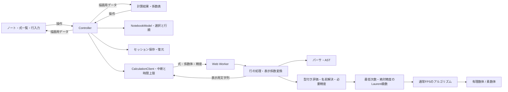

# FPS calculator 開発方針

## 最初に固定する意味

式は解析的関数の近似ではなく、係数体K上の形式冪級数と形式Laurent級数を表す。打ち切り次数Nは `f+O(x^N)` の絶対精度であり、多項式の次数上限や保持する係数の数とは区別する。通常FPSでは `K[[x]]/(x^N)` の精度に対応する。Laurent級数は最低次数mからN-1までを低次から格納する。xが可逆なK((x))で、(x^N)による商環と解釈しない。

`inv` は乗法逆元、`revert` は合成逆関数とする。log/expは通常FPSの定数項が1/0の場合を扱う。Laurent級数は四則演算・整数べき・微分・係数抽出・map、およびx^(-1)項が0の場合の積分に対応する。定数の一般的な対数・指数とPuiseux級数は対象外とする。エラー時に浮動小数点やゼロ埋めへ暗黙に退避しない。

UIの基底切り替えは `c_n ↔ a_n=n!c_n` という同じFPSの表示である。入力係数列をOGF/EGFとして取り込む機能を追加する場合は、別操作で明示的に変換する。E.G.F.基底における積は二項係数を含む畳み込みになり、通常の係数列畳み込みと取り違えない。標数pでは階乗を割れない場合があるため、任意標数のdivided-power代数への拡張は別の設計課題とする。

## レイヤーと精度

`main.ts` はスタイルの読込と `app/controller.ts` の起動だけを行う。状態の変更はcontrollerとNotebookModel、DOMの作成・更新は各View、非同期計算の管理はCalculationClientに分ける。フレームワークや新しいランタイム依存は追加しない。

| 場所 | 責務・依存の境界 |
| --- | --- |
| `model/calculation.ts` | UIとWorkerの入出力型、級数結果の型判定。DOMも評価器も参照しない |
| `config/limits.ts` | 行数・項数・文字数・精度・指数・サイズ・幅の共有上限 |
| `app/notebook-model.ts` | 追加削除・並べ替え・選択。DOMに触れず、現在の順序から次の選択を決める |
| `app/session.ts` | 未知の保存データを検証し、許可した項目だけを復元。Storageは外から受け取り、拒否・破損も処理する |
| `app/calculation-client.ts` | Workerを所有し、デバウンス・世代番号・中断・旧応答破棄・重複応答破棄・時間上限を管理する |
| `app/controller.ts` | Viewの操作を受け、モデル変更・保存・計算要求・再描画を連携させる |
| `ui/components/` | NotebookView / ExpressionList / ExpressionRow / InspectorView / CoefficientTableの単位でDOMを所有する |
| `ui/interactions/` | 入力カーソルと横スクロール、パネル幅、行ドラッグのブラウザ操作 |
| `ui/result-format.ts` | ラベル・プレビュー・コピー書式を生成するDOM非依存処理 |
| `ui/math.ts`, `ui/clipboard.ts` | KaTeXとクリップボードのブラウザAPI境界 |
| `styles/` | 基本・レイアウト・ノート・結果・レスポンシブの順でCSSを読み込む |

`workbook.ts` は公開計算APIを維持し、従来の型・MAX_ROWS/MAX_TERMSも再エクスポートする。新しいUIはmodelとconfigを参照し、計算実装を直接読み込まない。構文と評価の実装は従来どおりlanguage/coreに分ける。組み込み関数の名前・引数数・組合せ関数の別名は `language/builtins.ts` の定義をパーサと評価器で共有する。

セッションの保存形式は `version:1` のままにし、既存の式・行順・表示形式・入力幅を復元する。NotebookModelとsession、CalculationClientはDOMなしでテストできる。CalculationClientのWorker生成・デバウンス時間・時間上限は差し替えられるため、実ブラウザを起動せずに競合と中断を検証できる。

1. `Field<T>` を通して演算し、有理数・modのアルゴリズムを共通化する。初期実装の `bigint` はmod乗算にも用い、JavaScriptの `number` で安全整数を超えた乗算をしない。
2. `LaurentSeries<T>` は絶対精度と最低次数を保持し、通常FPSのアルゴリズムには `Series<T>` を使用する。公開演算は新しい配列を返す。切り捨てはできるが、既に失った情報をゼロとして精度を増やさない。
3. パーサは手書きの再帰下降構文解析でASTを返す。組み込みの `eval` / `Function` は使わない。`language/evaluator.ts` で型付きの値を評価し、`workbook.ts` が行ごとの結果と表示係数を生成する。新しい関数は引数数・定義域・精度規則を伴って追加する。
4. 名前定義はワークブック全体から解決し、前方参照を認める。同名の複数定義はエラーとする。現在は評価スタックで循環経路を報告する。
5. 式の評価は「欲しい精度」を引数に取る。`diff(f)` のN項にはfのN+1項、`integral(f)` には通常N-1項が必要。名前参照も `(名前, 精度)` ごとにキャッシュし、表示用N項を微分して最高次を偽の0にしない。
6. AST・係数体・計算結果はDOMから独立させる。Workerには式と設定を渡し、厳密値を整形した文字列を返す。4秒の上限はUI側でWorkerをterminateすることで実装する。

初期実装は理解しやすい漸化式・素朴畳み込みを正解基準として残す。合成はHorner法、反転はLagrange反転公式を使う。有限体での分母が0になる場合は未定義としてエラーにする。現方式では標数により計算できない反転であっても、別の方式なら計算可能な場合があるため、将来は演算単位で必要条件を緩和できる。

## 型付きの式言語

値はスカラー・級数・ラムダ・真偽値の直和型。級数は内部では共通のLaurent型で保持し、負の次数の有無でFPS/Laurentを表示する。`3` と `fps(3)` は区別する。混合四則演算はスカラーを定数FPSに昇格し、微積分もスカラーを定数FPSとして扱う。級数を整数や真偽値へ暗黙変換しない。`f[k]` / `coeff(f,k)` は通常係数のスカラーを返し、表示Nとは独立にmax(1,k+1)の精度を要求する。精度不足のラムダ引数などから未知の係数をゼロ埋めで取得しない。

スカラーは係数体上の値とmod前の厳密な有理数を持つ。通常の四則演算は両方に適用し、次数・添字・整数べき・階乗・組合せの引数と比較は厳密値を使う。mod2でも次数2を次数0と比較しない。FPSから抽出した有限体の係数は非負代表元を厳密値とする。階乗・組合せは整数上で計算してから写し、小さい標数で階乗の逆元を使わない。第1種スターリング数は符号なしで定義する。

`fps(n=>式)` は通常係数を生成する。ラムダは局所環境を捕捉し、名前付き呼出しとネストも可能。`map(f,n=>式)` は添字、`map(f,(a,n)=>式)` は現在の係数と添字を受け取る。従来の `map(f,a^2)` も維持する。mapで束縛するaには入力FPSへの係数アクセサも保持し、`a[n+1]` を元の入力式へ必要精度付きで問い合わせる。変換済みの係数は参照しない。明示的なラムダの局所束縛はmapの補助名より優先する。

条件は真偽値のみ受け付け、`?:` / `if` と `&&` / `||` は選ばれた枝だけを評価する。例えば次数0で `1/n` を回避できる。評価回数・深さ・精度・整数関数の引数・スカラーサイズに上限を設け、Workerの時間制限も維持する。

## Laurent級数と必要精度

非零級数fを `x^v U(x)`、`U(0)≠0` として扱う。除算と整数べきはxの因子を分離して、Uに対する既存の通常FPSアルゴリズムを使う。最低次数が負でも係数は有限個の負の項を持つ。負の項がすべて相殺されれば、最低格納次数を0へ戻して通常FPSとして表示する。

入力fの精度P、位数vに対し、逆元は一般に `O(x^(P-2v))` の精度になる。したがって出力Nには入力N+2vが必要。f/gの位数をa-bとすると、出力NにはfをN+b、gをN-a+2bまで要求する。積fgにはfをN-b、gをN-aまで、整数べきf^kにはfをN-(k-1)aまで要求する。現在の入力で足りなければ、ASTと名前参照を要求精度付きで再評価する。正の位数がある場合は既知の精度を余分に切り捨てない。

係数列が有限精度内で全て0の場合は、その精度まで零と分かるだけで、恒等的な零や位数∞と断定しない。分母・逆元では精度を倍増して最大512まで非零項を探す。見つからなければ「零級数または位数上限」と報告する。極の次数は128までとし、必要な入力の絶対精度にも512の上限を設ける。これらは計算資源の制限であり、数学的な零除算の判定と区別する。

Laurentの微分は次数を保って各係数へ整数次数を掛ける。積分のx^(-1)項が非零ならlog(x)が必要なため拒否する。有限体では他の次数の除算も検証する。負の次数を持つ級数のlog/exp・平方根・合成・合成逆関数は未対応として拒否する。一般FPS乗でも負の項のない底を要求し、指数の負次数との乗算では入力精度を調整する。

mapは入力の最低格納次数からN-1までを対象とし、それより下は変換しない。n/iは実際の整数次数であり、負になる場合もある。E.G.F.表示は負の階乗を定義しないため、負の項を持つ結果に対して拒否する。係数コピーはLaurentの場合のみ最低次数を持つJSONとし、通常FPSの配列形式を維持する。

## 平方根とべき乗

整数べきはスカラー式で指定でき、二分累乗を使う。一般の有理数乗とFPS乗は定数項1の底に対し `exp(g*log(f))` を使い、標数による除算条件を維持する。分母2の有理数べきは平方根と整数べきで計算するため、定数項が平方であれば1以外の底や偶数の正の位数にも対応する。一般の非単位FPSの高次根・Puiseux級数は対象外。

平方根は有理数体で整数の完全平方判定を使い、有限体はTonelli–Shanks法を使う。初期係数の根は有理数で非負、有限体では小さい代表元を選ぶ。FPSは先頭の位数が偶数である必要があり、標数2には未対応。位数2mの場合、出力N項には入力N+m項を要求する。N項で非零係数が見つからなければ2N項まで確認する。根の漸化式は2と先頭係数でのみ割るため、奇標数ではNがpを超えても計算可能な場合がある。

## 数式表示

`language/tex.ts` はASTと表示係数からTeX文字列を生成し、評価器やWorkerにDOM依存を持ち込まない。KaTeXはUIだけで利用し、`trust:false`・展開上限・大きさ上限を設定する。TeXを直接実行する入力欄ではない。入力文字列をHTMLへ差し込まず、TeXソースはtextContentで表示する。フォントもビルドに同梱し、実行時にCDNへ問い合わせない。

TeX生成は各子ASTを一度だけ走査する。子を事前にTeX化した後に括弧付け処理でも再走査すると、長い左結合式で指数時間になるため避ける。長い加算式でも係数計算とTeX生成を完了する回帰テストを置く。

係数表と横向き級数を切り替え、OGFでは負の次数を含むxべき、EGFでは非負次数のx^n/n!を描画する。最後には絶対精度のO(x^N)を付け、負の項の数だけO項の次数を増やさない。スカラーにはO項を付けない。

## 長い式の編集と並べ替え

`ui/interactions/resize-panel.ts` に入力パネルの幅調整、`input-scroll.ts` に入力行の横スクロール、`reorder-rows.ts` にPointer Eventsによる並べ替えを分ける。係数計算や式の意味は変更しない。幅はCSS変数でグリッドへ反映し、画面幅に応じた上限を設ける。保存する希望幅と、狭い画面へ収める実際の幅を分ける。境界のドラッグ・キーボードと拡大ボタンを提供し、スマートフォンは上下レイアウトにする。

各入力要素はCanvasの文字幅計測で式全体を収める幅にし、外側の行内コンテナへ横スクロールを持たせる。入力・カーソル移動時だけカーソルを可視範囲へ戻し、手動スクロールでは入力位置を変えない。グリッドと各列はmin-width:0を保ち、長い式でページ全体が横へ広がらないようにする。

行のドラッグは専用の取っ手から始め、式内の文字選択と分離する。挿入線を表示し、ドロップ時だけNotebookModelの行順を更新する。取っ手の上下キー・Home/Endにも対応する。タッチとマウスを同じPointer Eventsで扱い、端では一覧やページを自動スクロールし、Escapeやpointercancelでキャンセルする。

並べ替えでは行IDを維持し、ExpressionListがIDに対応するExpressionRowのDOMを再利用して必要な移動・追加削除だけを行う。選択中の行ID・入力の選択範囲・行内スクロール位置を維持し、行番号と操作ラベルを更新する。フォーカスを戻す間は選択イベントを再通知しない。削除時の位置は元の作成順を捕捉せず、NotebookModelが現在の行順から求める。係数結果は行IDで対応するため、並べ替えだけではWorkerを再起動しない。行順と希望幅を既存のバージョン付きlocalStorageへ保存する。

## 段階的な実装

| 段階 | 内容 | 次へ進む基準 |
| --- | --- | --- |
| 0: 実装済みの基盤 | 単変数FPS/Laurent・厳密係数・型付き式・主要演算・平方根/べき乗・組合せ・ラムダ/map・条件・TeX・Worker・表示切り替え | 既知の係数・恒等式・精度・定義域テストとビルドが通る |
| 1: 日常利用 | 入力位置付きエラー表示、数式エディタ、undo/redo、JSON入出力、URL共有、ブラウザE2EのCI化 | 編集中の入力保持、保存/復元、コピー、エラー回復を検証 |
| 2: 限定された再帰 | SCC依存解析、x進収縮が確認できる再帰定義、解の定数項の指定 | Catalan型の再帰を解け、非一意・未対応の循環を説明できる |
| 3: 連立暗黙方程式 | `F(x,y)=0`、初期定数ベクトル、Jacobian、形式Newton法 | 可逆性・枝の選択を検証し、残差0を指定精度まで確認 |
| 4: 大きい精度 | mod乗算のNTT、Newtonによるinv/log/exp/revert、Worker再利用・キャッシュ | 素朴実装との一致とベンチマークに基づき切り替える |
| 5: 多変数 | 次数体系、疎な係数表、多変数合成・偏微分・必要なら連立逆写像 | 切り捨て規則と項数予算を固定し、単変数へ退化した結果が一致 |

表示基底、ラムダ、隣接係数・階乗・条件式を使うmap、入力幅調整と行の並べ替えは実装済み。ラムダも式言語内で解釈し、自由なJavaScriptコールバックを受け取らない。今後はHadamard積専用演算や係数列の取込を、それぞれの精度規則とともに追加できる。

## 循環参照と連立方程式

循環参照を単に再帰評価すると停止しない。名前の依存グラフを強連結成分（SCC）へ分解し、非循環部分は従来通り、循環部分は明示的なソルバーへ渡す。式定義と方程式をUIで区別し、解の存在と一意性を確認する。

最初の対象は `f=1+x*f^2`、`f=x*exp(f)` のように、未知数の更新がx進位数を増やす系とする。`y=Φ(x,y)` で指定定数解y₀の近傍において `∂Φ/∂y(0,y₀)=0` が成り立つ場合など、収縮を証明できる範囲で反復する。「係数がしばらく変わらない」だけで正しい一意解と認めない。`f=f` や `f=f+1` はそれぞれ非一意・解なしであり、通常の計算として受け入れない。

一般の系は、初期定数ベクトルy₀が `F(0,y₀)=0` を満たし、`∂F/∂y(0,y₀)` が係数体上で可逆な場合から対応する。ASTの自動微分などで未知関数に関するJacobianを構築し、形式Newton法 `y ← y - J⁻¹F` で精度を倍増する。`y=Φ` の形なら可逆性条件は `I-∂Φ/∂y` に対するものになる。xに関する `diff` と未知数に関する微分を混同しない。

定数項に複数の解がある場合はユーザーが枝を指定する。modでは有理数体と異なる特異点が生じる。Jacobianが特異な系、負の位数が必要な系、分岐を持つPuiseux級数は、最初の連立ソルバーの対象外とする。解は代入後の残差が `0 mod x^N` であることも確認する。

## 高速化の順序

競技プログラミングでは998244353のNTTが有用だが、最初から汎用式評価と高速畳み込みを同時に複雑にしない。まず素朴版とランダムな小入力で照合できるようにし、演算数と有理数のビット長を測定する。

- 適合する素数ではNTTとNewton法を導入する。素数ごとに原始根・変換長上限を検証し、非対応modには素朴法の経路を残す。
- 数値精度を維持したmod乗算を使う。`number` への無条件変換は行わず、必要ならWASMを検討する。
- 有理数の分母増大には約分・交差約分・係数サイズの制限を検討する。NTT対応だけで有理数演算が高速化すると考えない。
- 大規模な合成・合成逆関数は乗算より高コストであり、単独で性能評価する。

## 多変数

単変数の密な配列へ無理に詰め込まず、`MultivariateSeries` を別型で作る。最初は `Map<monomialKey, coefficient>` の疎表現を候補とし、変数リストと指数ベクトルを持たせる。

先に「全次数がN未満」か「変数ごとの矩形精度」かを決定する。初期案は全次数N未満。d変数で保持し得る単項式の数は `binomial(N+d-1,d)` なので、Nだけでなく総項数も制限する。偏微分では必要な入力次数が増え、合成時には内側の各級数の定数項0が必要になる。E.G.F.表示は多重添字ごとの階乗積を用いる。

UIは係数表に単項式列とフィルタを加える。1変数の逆関数をそのまま多変数へ拡張せず、逆写像としてJacobianの条件を明示する。

## 検証とGit管理

実行環境はNode.js 24以上。`.nvmrc` とpackage.jsonのenginesだけでは古いNode.jsの使用を防げないため、npmスクリプトはNode.js 12でも読める `scripts/run.cjs` を入口とする。システムのNode.jsが要件未満なら `.local/node/bin/node` を検証して使い、見つからなければセットアップ手順を表示する。Viteの依存内で構文エラーが出る前に対処できるようにする。

Linux/macOS向けの `scripts/setup-node.sh` は公式配布をSHA-256検証し、無視対象の `.local/node/` に導入する。システム設定は変更しない。依存のインストールは対応するNode.jsのPATHで実施する。CIはsetup-nodeで24を導入するため、通常のシステムランタイム経路を使う。

既知の展開（幾何級数・exp/log・Catalan数）、`exp(log f)=f`、`f*inv(f)=1`、合成逆関数の左右両方向、微積分の恒等式を係数体ごとに検証する。小さい素数で割れないケース、N=1、微分後の最高次、前方参照、循環、重複名も対象とする。

Laurentは `exp(x)/x` と `x^(-2)*exp(x)` の最高表示次数、正負両方向の位数の商、負次数の相殺、有限体で先頭項が消える分母を検証する。単項式と幾何級数の商を独立した係数公式と照合する。

ブラウザ検証では、入力を続けてもフォーカスが失われないこと、Workerの旧結果が新しい入力を上書きしないこと、mod/基底変更、行の追加削除、保存復元、狭い画面を確認する。高速化を追加したら素朴版との照合テストを追加する。

幅・並べ替えの変更では、長い式の横スクロールとカーソル追従、境界のマウス/キー操作、マウス/タッチでの並べ替え、キー移動・キャンセル、移動後の選択結果・入力位置・削除、保存復元、狭い画面でのはみ出しを確認する。

アプリ層は `tests/app.test.ts` で保存形式の互換性・入力検証・保存拒否・行移動後の選択/削除・最後の空行・行数上限・コピー書式を検証する。Workerは差し替えた実装で応答時刻を制御し、旧応答/重複応答の破棄・デバウンス中の中断・タイムアウト後の回復を検証する。

依存は `package-lock.json` に固定し、CIは `npm ci` → 型検査 → テスト → ビルドを行う。生成物・依存・秘密情報は `.gitignore` で除外する。依存追加は計算の正しさや編集体験に必要なものに絞る。

GitHub Pagesへの公開は `.github/workflows/deploy.yml` が担当する。`main` のpushまたは `main` を選んだ手動実行で、`npm ci` → テスト → 型検査を含むビルド → Pages用artifactのアップロード → 公開を順に行う。Viteのビルド引数 `--base=/FPS-calculator/` でWorker・CSS・フォントを含むアセットの配信先を揃え、`dist/` はGit管理せずActionsで受け渡す。公開先の変更時はREADMEとビルド引数を更新する。

参照: [形式冪級数の基礎（Sambale）](https://benjaminsambale.github.io/pdfs/fopose.pdf)、[合成逆関数のアルゴリズム（Johansson）](https://arxiv.org/abs/1108.4772)、[Vite公式](https://vite.dev/guide/)、[TypeScript BigInt](https://www.typescriptlang.org/docs/handbook/2/everyday-types.html#bigint)、[KaTeX API](https://katex.org/docs/api)、[KaTeXの描画設定](https://katex.org/docs/options)。

Laurentの表現・位数・相対精度: [SageMath Laurent series reference](https://doc.sagemath.org/html/en/reference/power_series/sage/rings/laurent_series_ring_element.html)。
