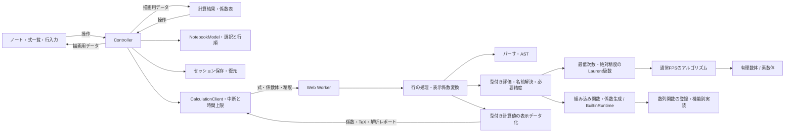

# FPS calculator 設計書

この文書は内部構造・数学的な計算契約・状態管理の設計を記録する。利用方法・構文・定義域・数値上限は[README](../README.md)、検証手順は[検証ガイド](testing.md)、未実装部分は[ロードマップ](roadmap.md)を正とする。実装済み機能の追加計画や作業履歴は重ねて記録しない。

## 計算の基本契約

- 係数は常にField<T>経由で演算する。有理数・modをnumberへ変換して近似しない。numberは制限内の添字・項数・指数に使う。
- 精度Nは絶対精度O(x^N)。通常FPSのK[[x]]/(x^N)と、xが可逆なLaurent級数K((x))を区別する。後者を(x^N)による商環として扱わない。
- 未知の高次係数を0と仮定して精度を拡張しない。ソルバーの反復用近似と、確定した級数の精度を区別し、残差検証後だけ確定キャッシュを更新する。
- スカラー・定数FPS・ラムダ・真偽値・解析レポートの型を維持する。昇格は式言語で明示した規則だけで行う。係数抽出・mapは常に通常係数、OGF/EGFは同じFPSの表示基底である。
- invは乗法逆元、revertは合成逆関数。未対応の枝・非因果的な循環・特異性を黙って別の意味に解釈せず、特異な系を解なしと断定しない。
- 式にeval/new Functionを使用せず、計算にDOMを持ち込まない。文字列はtextContent/value、KaTeXへはASTから生成したTeXだけを渡す。

## 構成と責務

責務の境界は実行時の依存にも反映する。Evaluatorと数列関数は共通の `language/values.ts` を使い、数列側は `SequenceRuntime` のコールバックだけで評価器を呼ぶ。`sequence-functions.ts` では登録表から候補名とハンドラを取り出し、`sequences/context.ts` へ引数の型・添字・要求精度を集約する。数列の数学は引き続きcoreに置く。

EvaluatorはASTの評価・名前解決・評価予算・原文診断とLaurent演算の追加精度を所有する。`language/evaluation/builtin-functions.ts`が組み込み関数の引数検証と演算の選択、`coefficient-functions.ts`がfps/egf生成とmapの局所束縛・隣接係数参照を所有する。`evaluation/runtime.ts`は評価器へのコールバック契約のみで、実装側からEvaluatorクラスを参照しない。コールバックは呼出し元のscopeに束縛し、ラムダ本体やmapの補助名を評価する場合だけ明示的なscopeを渡す。すべての再評価はEvaluator.evaluateを通し、精度・サイズ・評価回数・SourceErrorの制限を迂回しない。

`implicit-workbook.ts`はSCC・正規化・解法選択・フォールバックの順序と解のキャッシュを所有する。`implicit-solvers.ts`は代数・微積分・次数依存の3解法ごとに初期係数を検証し、コンパイラとcoreソルバーを接続する。生成側は名前解決やキャッシュを持たず、評価・外部解参照はコールバックを使う。正規化で方程式が更新されるため、生成時点の方程式を渡す。失敗した次数依存の試行をキャッシュへ登録せず、正則系の診断と既存のフォールバック順序を維持する。

NotebookToolsは配置と通知、DocumentActionsViewはファイル/クリップボード操作、VariableRenameViewはフォームと候補、TemplateLibraryViewは分類・検索・選択・プレビューに分ける。JSON検証・ノート置換・名前変更の束縛検証・履歴はcontroller/appへ残す。InspectorViewはツールバーとコピーを扱い、ResultBodyViewが係数表・級数・解析・エラーを描画する。子ViewからWorkerや保存を直接開始しない。

ExpressionRowは行の配置・番号・並べ替え取っ手・複製/削除・結果プレビューを所有し、入力処理をRowSource・RowInitial・RowCommentへ分ける。各部品が同じ入力DOMを保ち、IME確定・編集前の入力位置・履歴境界・構文支援のライフサイクルを所有する。共通の型は`expression-row-types.ts`、履歴用の選択範囲・スクロール位置の取得は`interactions/editor-state.ts`へ置く。子部品は親コンポーネントの型に依存しない。RowSourceは渡されたhostへ入力を配置してからCodeEditorを生成し、横スクロール領域と診断ボタンの兄弟関係を保つ。ExpressionRowからの型再exportとinput/editor/initialInputの参照は互換性のため維持する。

CompletionMenuはCodeEditorが渡すIME状態を確認し、補完確定を従来のbeforeinput/inputイベントへ流す。候補のポップアップとviewportのイベントはCompletionMenu、ResizeObserverと色分けオーバーレイはCodeEditorが片付ける。行の破棄では両方をdestroyし、入力のDOM・選択・スクロールを保つ。

`main.ts`はスタイルの読込と`app/controller.ts`の起動のみ。状態の変更はcontrollerとNotebookModel、DOMの作成・更新は各View、非同期計算はCalculationClientへ分ける。



| 場所 | 責務・依存の境界 |
| --- | --- |
| `model/calculation.ts` | UIとWorkerの入出力型、級数結果の型判定。DOMも評価器も参照しない |
| `config/limits.ts` | 行数・項数・文字数・精度・指数・サイズ・幅の共有上限 |
| `app/notebook-model.ts` | 追加削除・並べ替え・選択。DOMに触れず、現在の順序から次の選択を決める |
| `app/edit-history.ts` | undo/redoスタック、連続編集の集約、履歴上限。スナップショットの型は呼出し側が決める |
| `app/session.ts` / `notebook-document.ts` | ブラウザ保存・JSONの共通検証、許可した項目だけの復元。Storageは外から受け取る |
| `app/sharing.ts` / `rename-variable.ts` / `templates.ts` | URLの符号化・復元、束縛付き名前変更、分野別サンプル集の集約・検索・プレビュー。DOMに依存しない |
| `app/calculation-client.ts` | Workerを所有し、デバウンス・世代番号・中断・旧応答破棄・重複応答破棄・時間上限を管理する |
| `app/controller.ts` | Viewの操作を受け、モデル変更・保存・計算要求・再描画を連携させる |
| `ui/components/` | ノート・式一覧・行入力・連立欄・結果ツールバー/本体の単位でDOMを所有する |
| `ui/components/notebook-tools.ts` | ツールの配置と通知欄。JSON/共有、名前変更、サンプル集の状態はそれぞれ子Viewが持つ |
| `ui/components/expression-row.ts` / `row-source.ts` / `row-initial.ts` | 行の配置と操作、数式入力、再帰初期係数入力を分離。子がCodeEditorを所有し破棄する |
| `ui/components/expression-row-types.ts` / `ui/interactions/editor-state.ts` | 行編集の共通契約と、選択範囲・スクロール位置の取得 |
| `ui/components/input-help.ts` | 静的な構文ガイド。ノートの状態や操作を持たない |
| `ui/interactions/code-editor.ts` / `completion-menu.ts` | 前者は色分け・括弧・エラー描画とIME表示、後者は補完候補のDOM・選択・確定 |
| `language/values.ts` / `expression-range.ts` | 評価器から独立した値型、ASTの原文範囲。数学の評価からエディタ支援への依存を避ける |
| `language/evaluation/` | BuiltinRuntimeを通した組み込み関数の処理・fps/egf/map。EvaluatorクラスやDOMに依存しない |
| `language/implicit-solvers.ts` | 解法ごとの初期係数検証とコンパイラ・ソルバーの生成。SCC・解法選択・キャッシュは持たない |
| `language/sequence-functions.ts` / `sequences/` | 数列関数の登録表、評価器とのコールバック境界、引数検証、多項式解析、演算別ハンドラ |
| `language/aggregate.ts` / `infinite-bound.ts` / `degree-range.ts` | 型を維持する有限総和・総積、無限の尾の次数下界の証明、範囲付き生成の検証 |
| `language/causal-expression.ts` / `core/causal-system.ts` / `coefficient-series.ts` | 係数への遅延参照、循環・未来参照の検出、次数順の確定と初期係数・残差検証 |
| `core/euler-transform.ts` | Field上のEuler変換。DOM・名前解決・浮動小数点を持ち込まない |
| `core/analytic-coefficients.ts` / `analytic-series.ts` | 厳密有理数のTaylor係数と導関数、位数に応じた合成、EGFのn!の重み |
| `language/analytic-functions.ts` | 三角関数群の導出関数を既存の四則演算・平方根等のASTへ展開 |
| `ui/components/row-comment.ts` | Plain textのコメント欄。IME・入力位置・履歴の接続。式の解析や実行はしない |
| `calculation/format-value.ts` | 計算済みValueをRowResultへ変換。OGF/EGF・TeX・解析の整形を所有し、名前解決や状態変更はしない |
| `ui/interactions/` | 入力カーソルと横スクロール、パネル幅、行ドラッグのブラウザ操作 |
| `ui/result-format.ts` | ラベル・プレビュー・コピー書式を生成するDOM非依存処理 |
| `ui/math.ts`, `ui/clipboard.ts` | KaTeXとクリップボードのブラウザAPI境界 |
| `styles/` | 基本・レイアウト・ノート・結果・レスポンシブの順でCSSを読み込む |

## 公開APIと互換性

`workbook.ts` は公開計算APIを維持し、従来の型・MAX_ROWS/MAX_TERMSも再エクスポートする。新しいUIはmodelとconfigを参照し、計算実装を直接読み込まない。構文と評価の実装は従来どおりlanguage/coreに分ける。組み込み関数の名前・引数数・組合せ関数の別名は `language/builtins.ts` の定義をパーサと評価器で共有する。

セッションの保存形式はversion:1を維持する。EvaluatorのValue型再export、ExpressionRowの型再exportとinput/editor/initialInput参照も維持し、内部モジュールはそれぞれvalues.tsとexpression-row-types.tsを参照する。

## 状態管理と履歴

編集履歴はcontrollerが操作の直前にNotebookModelのスナップショットとViewから取得した入力位置を記録する。式の編集・行の追加/削除/複製/移動と計算設定を対象とし、選択・入力幅・結果の表示形式は独立させる。変更がなかった操作では履歴やredoを更新しない。同じ欄の短時間の連続入力は共有上限の期間で集約し、カーソル移動・フォーカス移動・貼り付け・IME変換で区切る。undo後の編集はredoを破棄する。

undo/redoでは行IDと選択を含む入力をコピーして復元し、session.inputの参照を維持して保存する。数式入力のカーソル・選択範囲・スクロール復元はExpressionListが所有し、復元中は選択イベントを再通知しない。計算に必要な内容が変わった場合はCalculationClientが古いWorkerを破棄して再計算し、行順だけの復元では結果をIDで再利用する。履歴自体は保存せず、再読み込み時は空から始める。

ボタンはNotebookView、Ctrl/Meta+Z・Shift+Z・Ctrl+YとネイティブのhistoryUndo/historyRedo入力は `ui/interactions/history-shortcuts.ts` が扱う。アプリ内の履歴とブラウザのテキストundoを二重に適用しない。IME変換中のキー操作は奪わず、Enterでも行を追加しない。

数式のIME変換は確定時に1回だけモデルと履歴へ反映する。変換中のDOM入力はWorkerの応答による再描画で上書きせず、変換中の時間経過によって履歴を分割しない。取り消した変換で内容が元に戻った場合は履歴やredoを変更しない。

## 型付きの式言語

組合せの予約語は `nCk` / `nPk` / `nHk` とし、関数記法と空白で区切った中置記法を持つ。単独のC/P/Hはユーザーの識別子として扱い、旧構文5C2等の字句分割は行わない。乗算の省略はパーサが通常の乗算ASTへ変換する。`2X` や `2F` の数値と識別子、隣接する括弧式に対応し、乗除算と同じ優先順位・左結合を保つ。識別子FGは分割せず、名前や呼出しの後の括弧は関数・ラムダの呼出しとして優先する。`2nCk(5,2)` は関数値への乗算、`5 nCk 2` は組合せ中置演算として区別する。

値はスカラー・級数・ラムダ・真偽値・解析レポートの直和型。漸化式の過去係数参照には内部history型を使う。級数は内部では共通のLaurent型で保持し、負の次数の有無でFPS/Laurentを表示する。`3` と `fps(3)` は区別する。混合四則演算はスカラーを定数FPSに昇格し、微積分もスカラーを定数FPSとして扱う。級数を整数や真偽値へ暗黙変換しない。`f[k]` / `coeff(f,k)` は通常係数のスカラーを返し、表示Nとは独立にmax(1,k+1)の精度を要求する。精度不足のラムダ引数などから未知の係数をゼロ埋めで取得しない。

スカラーは係数体上の値とmod前の厳密な有理数を持つ。通常の四則演算は両方に適用し、次数・添字・整数べき・階乗・組合せの引数と比較は厳密値を使う。mod2でも次数2を次数0と比較しない。FPSから抽出した有限体の係数は非負代表元を厳密値とする。階乗・組合せは整数上で計算してから写し、小さい標数で階乗の逆元を使わない。第1種スターリング数は符号なしで定義する。

`core/special-series.ts` にCatalanとLambertWの係数計算を置く。Catalanは整数係数の漸化式で生成し、単独の予約語で母関数、関数呼出しで定数項0のFPSとの合成を返す。LambertWは原点で0の枝の係数 `(-n)^(n-1)/n!` を厳密有理数で約分後に体へ写し、Horner法で合成する。入力の位数から必要な外側係数の次数を求め、不必要な分母の逆元を要求しない。係数抽出・微分・Laurent除算から要求された精度にも従う。負の次数や非零の定数項は拒否する。

`fps(n=>式)` は通常係数を生成する。`fps(lambda,lo,hi)`は両端を含む次数範囲、`fps(lambda,lo)`はlo以上を生成し、範囲外を定義上0としてラムダを実行しない。範囲は0〜10000、lo>hiは零FPS。スカラーからのfps生成には範囲を付けない。ラムダは局所環境を捕捉し、名前付き呼出しとネストも可能。`map(f,n=>式)` は添字、`map(f,(a,n)=>式)` は現在の係数と添字を受け取る。従来の `map(f,a^2)` も維持する。mapで束縛するaには入力FPSへの係数アクセサも保持し、`a[n+1]` を元の入力式へ必要精度付きで問い合わせる。変換済みの係数は参照しない。明示的なラムダの局所束縛はmapの補助名より優先する。

### EGFの生成

`egf(lambda,lo,hi)`はfpsと同じ範囲と捕捉の規則でa_n/n!を通常係数として生成する。`egf(n=>1)=exp(X)`。`egf(FPS)`は入力係数をEGFの重みとして取り込み、seq由来のknownTermsを保つ。スカラーは定数FPSとし、範囲はラムダの場合だけ許す。係数体上でn!を作って除算し、標数でn!が0なら分子が0でもエラーにする。有限体の重みを整数へ勝手に持ち上げない。範囲外はラムダも除算も実行しない。生成後の値は普通のFPSで、表示基底・map・係数抽出の意味は変えない。次数依存の循環内でも同じ生成規則を使う。

### 三角関数群と形式的な枝

sin/cos/sinh/cosh、arcsin/arctan/arcsinh/arctanhを原点のTaylor核とする。`analytic-coefficients.ts`が係数を厳密有理数で約分してからFieldへ写す。inputの位数vなら出力N項に必要な外側の次数はfloor((N-1)/v)までとし、不必要な分母で小標数を拒否しない。スカラー0にはスカラーを返し、FPSにはFPSを返す。非零の定数項での一般の超越定数は近似しない。

tan/cot/sec/csc、tanh/coth/sech/cschは四則演算へ展開し、csc/cot等の極に伴う追加精度を既存のLaurent評価器へ伝える。arccos/arccoshは定数項1の結果0となる枝を選び、2*arcsin(sqrt((1-f)/2)) / 2*arcsinh(sqrt((f-1)/2))で計算する。根の位数・係数体を検証する。arccos(X)のπ/2を捨てたり、Puiseux級数を通常FPSと解釈したりしない。arccot/arccsc/arccoth/arccschは逆数の定数項0の枝、arcsec/arcsechは逆数にarccos/arccoshを適用する。a付きの一般的な別名もbuiltinDefinitionsに集約する。

次数依存ソルバーはTaylor核の遅延合成を使う。正則系の自動微分はTaylor導関数の係数を乗算し、微積分系の展開にも各核の連鎖律を追加する。導関数の整数因子も有理数上で約分してから写し、不要な標数の障害を作らない。定義・展開の参考は[NIST DLMF §4.24](https://dlmf.nist.gov/4.24)、[§4.38](https://dlmf.nist.gov/4.38)。

### 式ごとのコメント

InputRowに任意の`comment?:string`を追加し、従来のversion:1のまま共通検証器で2000文字まで確認する。式とは別のplain textであり、AST・TeX・名前変更へ渡さない。JSON・URL・ブラウザ保存・複製・行操作・履歴のスナップショットに含め、ID等の共有除外規則は保つ。不正なコメントはノート全体の読み込み前に拒否する。

RowCommentはネイティブtextareaを保持し、IME確定時だけ編集を反映する。改行はそのまま入力でき、数式の補完やEnterでの行追加は適用しない。EditorStateにcommentフィールドと縦スクロールを追加し、行のDOM再利用・並べ替え・undo/redoで選択範囲とフォーカスを復元する。controllerのcomment操作は保存と描画だけを行い、calculationChangedはコメントの差分を無視してWorkerを再起動しない。

### 総和・総積とEuler変換

`sum(lo,hi,k=>term)` / `prod(lo,hi,k=>term)`は両端を含む有限演算で、全項がスカラーなら厳密値も保つ。空範囲の0/1はスカラーとし、ラムダを実行しない。FPSが混ざる場合は通常の昇格規則を使う。Laurentの有限積は負の位数の合計を見積もり、必要な追加精度で各因子を再評価する。添字はmod前の整数、最大4096項、±10000を上限とする。

上端なしの`sum(lo,lambda)` / `prod(lo,lambda)`はx進の収束を扱い、結果は通常FPS。`infinite-bound.ts`はk>=loで各項（積では因子-1）の位数が`s*k+b`以上となる下界を構文から導き、s>0の時だけ尾を除く。和は下界のmin、積は下界の和、微分/積分は-1/+1、合成は外側の既知位数と内側の下界の積として伝播する。指数のアフィン式とk^m>=k（k>=1、m>=1）を使える。単位の逆元・積・固定べきなどの1との差も扱う。単なる有限prefixの0から無限の尾を推測しない。任意の条件分岐、独自ラムダの展開、証明できない指数は有限範囲を要求する。開始添字は非負で、必要な項数にも4096の上限を適用する。

指数の完全なアフィン式と単なる下界は区別し、下界を引いたり負数倍したりして収束を誤判定しない。下界の演算は安全な整数範囲を検証し、打ち切り添字はBigIntの厳密な整数除算で求める。巨大な傾き・負の切片の相殺による丸めで必要な項を落とさない。

`eulerTransform(f)`は定数項0のfに対して`exp(Σ_{k>=1} f(X^k)/k)`を求める。f=Σc_n X^nなら`∏_{n>=1}(1-X^n)^(-c_n)`に一致し、fがサイズの母関数なら多重集合を数える。core実装は約数方向にlogの係数を集め、通常のexpを使う。素数modで割れない整数が必要なら明示的なエラーとし、指数を代表元の整数へ勝手に持ち上げない。整数指数の無限積は`prod(1,k=>1/(1-X^k))`等で小標数でも直接計算できる。

通常FPSの`f(g)`は`compose(f,g)`の短縮形とし、gの定数項0を要求する。`Series.compose`は単項式の内側に対して添字移動を使い、一般の合成は従来のHorner法を保つ。和・積・範囲付きfpsのTeXもASTから生成する。形式的な無限演算の考え方は[Sageの遅延級数](https://doc.sagemath.org/html/en/reference/power_series/sage/rings/lazy_series_ring.html)も参照する。

条件は真偽値のみ受け付け、`?:` / `if` と `&&` / `||` は選ばれた枝だけを評価する。例えば次数0で `1/n` を回避できる。評価回数・深さ・精度・整数関数の引数・スカラーサイズに上限を設け、Workerの時間制限も維持する。

## Laurent級数と必要精度

非零級数fを `x^v U(x)`、`U(0)≠0` として扱う。除算と整数べきはxの因子を分離して、Uに対する既存の通常FPSアルゴリズムを使う。最低次数が負でも係数は有限個の負の項を持つ。負の項がすべて相殺されれば、最低格納次数を0へ戻して通常FPSとして表示する。

入力fの精度P、位数vに対し、逆元は一般に `O(x^(P-2v))` の精度になる。したがって出力Nには入力N+2vが必要。f/gの位数をa-bとすると、出力NにはfをN+b、gをN-a+2bまで要求する。積fgにはfをN-b、gをN-aまで、整数べきf^kにはfをN-(k-1)aまで要求する。現在の入力で足りなければ、ASTと名前参照を要求精度付きで再評価する。正の位数がある場合は既知の精度を余分に切り捨てない。

係数列が有限精度内で全て0の場合は、その精度まで零と分かるだけで、恒等的な零や位数∞と断定しない。分母・逆元では精度を倍増して最大512まで非零項を探す。見つからなければ「零級数または位数上限」と報告する。極の次数は128までとし、必要な入力の絶対精度にも512の上限を設ける。これらは計算資源の制限であり、数学的な零除算の判定と区別する。

Laurentの微分は次数を保って各係数へ整数次数を掛ける。積分のx^(-1)項が非零ならlog(x)が必要なため拒否する。有限体では他の次数の除算も検証する。負の次数を持つ級数のlog/exp・平方根・合成・合成逆関数は未対応として拒否する。一般FPS乗でも負の項のない底を要求し、指数の負次数との乗算では入力精度を調整する。

mapは入力の最低格納次数からN-1までを対象とし、それより下は変換しない。n/iは実際の整数次数であり、負になる場合もある。E.G.F.表示は負の階乗を定義しないため、負の項を持つ結果に対して拒否する。係数コピーはLaurentの場合のみ最低次数を持つJSONとし、通常FPSの配列形式を維持する。

## 平方根とべき乗

整数べきはスカラー式で指定でき、二分累乗を使う。一般の有理数乗とFPS乗は定数項1の底に対し `exp(g*log(f))` を使い、標数による除算条件を維持する。分母2の有理数べきは平方根と整数べきで計算するため、定数項が平方であれば1以外の底や偶数の正の位数にも対応する。一般の非単位FPSの高次根・Puiseux級数は対象外。

平方根は有理数体で整数の完全平方判定を使い、有限体はTonelli–Shanks法を使う。初期係数の根は有理数で非負、有限体では小さい代表元を選ぶ。FPSは先頭の位数が偶数である必要があり、標数2には未対応。位数2mの場合、出力N項には入力N+m項を要求する。N項で非零係数が見つからなければ2N項まで確認する。根の漸化式は2と先頭係数でのみ割るため、奇標数ではNがpを超えても計算可能な場合がある。

## 数式表示

`language/tex.ts` はASTと表示係数からTeX文字列を生成し、評価器やWorkerにDOM依存を持ち込まない。KaTeXはUIだけで利用し、`trust:false`・展開上限・大きさ上限を設定する。TeXを直接実行する入力欄ではない。入力文字列をHTMLへ差し込まず、TeXソースはtextContentで表示する。フォントもビルドに同梱し、実行時にCDNへ問い合わせない。

TeX生成は各子ASTを一度だけ走査する。子を事前にTeX化した後に括弧付け処理でも再走査すると、長い左結合式で指数時間になるため避ける。長い加算式でも係数計算とTeX生成を完了する回帰テストを置く。

係数表と横向き級数を切り替え、OGFでは負の次数を含むxべき、EGFでは非負次数のx^n/n!を描画する。最後には絶対精度のO(x^N)を付け、負の項の数だけO項の次数を増やさない。スカラーにはO項を付けない。

## 長い式の編集と並べ替え

`ui/interactions/resize-panel.ts` に入力パネルの幅調整、`input-scroll.ts` に入力行の横スクロール、`reorder-rows.ts` にPointer Eventsによる並べ替えを分ける。係数計算や式の意味は変更しない。幅はCSS変数でグリッドへ反映し、画面幅に応じた上限を設ける。保存する希望幅と、狭い画面へ収める実際の幅を分ける。境界のドラッグ・キーボードと拡大ボタンを提供し、スマートフォンは上下レイアウトにする。

`#app`を100dvh（100vhへフォールバック）のGridとし、ヘッダの残りをworkspaceへ割り当てる。入力と結果の各パネルはmin-height:0・overflow-y:autoで独立してスクロールし、overscroll-behavior-y:containで端のスクロール連鎖を抑える。720px以下は同じworkspaceを上下各1frへ分割する。式一覧と結果本文には縦の最大高さを置かず、コメント・連立欄・係数表も所属パネルのスクロールで最後まで到達できる。パネルにはtabindexを付け、キーボードでもスクロール可能にする。行ドラッグの自動スクロールは最も近い実際にスクロール可能な祖先を使い、判定領域をその表示範囲に制限する。結果のスクロール位置やWorkerを巻き込まない。

各入力要素はCanvasの文字幅計測で式全体を収める幅にし、外側の行内コンテナへ横スクロールを持たせる。入力・カーソル移動時だけカーソルを可視範囲へ戻し、手動スクロールでは入力位置を変えない。グリッドと各列はmin-width:0を保ち、長い式でページ全体が横へ広がらないようにする。補完候補は入力パネルの表示範囲も考慮し、編集中の入力がその範囲外へスクロールしたら閉じる。

行のドラッグは専用の取っ手から始め、式内の文字選択と分離する。挿入線を表示し、ドロップ時だけNotebookModelの行順を更新する。取っ手の上下キー・Home/Endにも対応する。タッチとマウスを同じPointer Eventsで扱い、端では一覧やページを自動スクロールし、Escapeやpointercancelでキャンセルする。

並べ替えでは行IDを維持し、ExpressionListがIDに対応するExpressionRowのDOMを再利用して必要な移動・追加削除だけを行う。選択中の行ID・入力の選択範囲・行内スクロール位置を維持し、行番号と操作ラベルを更新する。フォーカスを戻す間は選択イベントを再通知しない。削除時の位置は元の作成順を捕捉せず、NotebookModelが現在の行順から求める。係数結果は行IDで対応するため、並べ替えだけではWorkerを再起動しない。行順と希望幅を既存のバージョン付きlocalStorageへ保存する。

## 保存と編集支援

`app/notebook-document.ts` がJSON入出力と既存version:1保存の共通検証を担当する。ポータブル形式は `{format:"fps-calculator",version:1,data,view}`。dataには行順・原文・initial・systems・計算設定を含め、IDs・幅・履歴は含めない。旧形式のformat省略も受け入れる。UTF-8で256 KiB、既存の行数・文字数・次数・連立欄上限を検証後に新規IDで復元する。式の数学的正当性やmodの素数性は通常の計算時に検証するため、編集中のノートも移動できる。ノートを部分的に上書きせず、controllerが検証済み内容を一括反映する。幅は受け手の設定を維持し、読み込みは表示形式を含め1回のundo対象とする。表示形式の単独変更は従来どおり履歴を増やさない。

`app/sharing.ts` は同じJSONをUTF-8/Base64urlでURLフラグメントに格納する。サーバー保存は行わず、12,000文字を超えるリンクはJSONへ案内する。復元成功後はfragmentを消して以後の編集と再読み込みを両立する。不正なリンクでは現在のノートを保持する。

`language/tokens.ts` の位置付き字句をパーサと色分けで共有する。ASTには宣言・symbol・整数・ラムダ引数の原文範囲を保持する。`SourceError` とWorker結果のdiagnosticはUTF-16の開始/終了オフセットを使い、ネイティブ入力の選択範囲と一致させる。`editor-analysis.ts` は構文診断・括弧対応・補完候補を純粋な処理として生成する。`ui/interactions/code-editor.ts` はネイティブinput/textareaを残し、テキストの色分け用オーバーレイと補完候補だけを重ねる。IME中は入力本体を表示し、補完確定はbeforeinput/input経由で既存の編集履歴へ流す。エラー位置ボタンで該当箇所を選択する。位置を特定できない連立エラー等は結果欄に残す。

`app/rename-variable.ts` は全欄を構文解析してから、グローバルな宣言と自由参照の原文範囲だけを後ろから置換する。ラムダ引数・mapのa/n/i・部分文字列を区別し、予約語・重複定義・局所名への捕獲・構文エラー・上限超過では全変更を拒否する。名前付きmapラムダに呼出し時に注入されるiが、グローバル名の変更で別の意味になる場合も拒否する（静的に確定できない間接変換は保守的に拒否）。原文書式と既存IDを保ち、初期値と連立未知数も扱う。一括変更は1回のundo対象とする。

## 数列と微積分系

`core/sequences.ts` は`Field<T>`だけを使い、線形漸化式、学習用の矩形線形系による候補推測、有理母関数の分子/分母、二項変換、p-recursive生成、微分作用素への変換を担当する。`language/sequence-functions.ts` が数列関数の登録を担当し、`sequences/recurrences.ts`・`analysis.ts`・`transforms.ts`へ委譲する。共通の型/精度検証はcontext.ts、係数多項式の抽出はpolynomial.tsへ分ける。関数の引数数はbuiltins.tsで集約し、seq等の可変引数も同じ検証器を通す。

recurrenceの履歴は通常スカラーとは別の内部値型historyを使う。a[k]で確定済みの過去係数だけを返し、未来・負添字・履歴自体の四則演算は拒否する。添字nはmod前の厳密整数。seqは既知の入力個数を保持し、guessで列挙後のゼロを勝手に検証データへ加えない。通常FPSの推測では要求されたN項を使う。

guessは低次数から学習データだけで候補を求め、一意性をrankで確認する。残りの項は次数選択・フィットに使わず、検証の成否と最初の不一致を表示する。解析値はanalysis型とし、係数体・説明行・再利用できる式をWorker経由で返す。レポートはtextContent、式のTeXは生成式をASTへ戻した結果から描画する。有限精度比較や推測を恒等性の証明と表示しない。

定係数漸化式 `a_n=Σ_(j=1)^r c_j a_(n-j)` は `Q=1-Σ c_j x^j`、`P=[Q Σ_(n<r) a_n x^n]_(<r)` からF=P/Qを厳密に復元する。p-recursiveは `Σ_(j=0)^r p_j(n)a_(n+j)=0 (n≥0)` とし、theta=xDを使って

```text
L = Σ_j x^(r-j) p_j(theta-j)
B = Σ_j x^(r-j) Σ_(m<j) p_j(m-j) a_m x^m
L F = B
```

を構成する。theta^k=Σ_l S(k,l)x^l D^lで通常の微分作用素へ展開し、境界項Bを落とさない。全係数に共通のx因子のみ除く。作用素の最小性・正則性は保証しない。一般の変換と初期境界条件の考え方は[gfun rectodiffeqの資料](https://perso.ens-lyon.fr/bruno.salvy/data/rectodiffeq.pdf)も参照する。各次数・項数の上限は[README](../README.md#入力と計算の上限)を参照する。

微積分系は`differential-normalize.ts`で積・商・連鎖律を展開し、未知関数の微分次数を解析する。`implicit-expression.ts`は代数系と微積分系で式コンパイルを共有するが、後者のderivativesは点ごとの偏微分ではなく、現在求める係数方向のFrechet微分とする。微分・積分は値と方向微分の両方へ作用させ、各子式の必要精度を調整する。精度1の積分は子式を評価せずゼロとする。

`core/differential-system.ts`が係数の確定順序と線形系を管理する。未知関数iの最大微分次数r_iに対し、出力次数nでa_(i,n+r_i)を求める。低次の初期係数をscalar/seqで受け取り、欠けた定数項はアフィン制約だけで推定する。最高階の定数係数はアフィンであることを検証し、必要ならその係数も初期値として与える。非線形な根を勝手に選択しない。

要求精度で確定できる係数だけを未知列とし、各方程式が参照する微分次数から、検証可能な行だけをその次数の線形系へ含める。これにより、mod pでN=pの有効なODEのprefixを、不要なa_pを求めて拒否しない。精度の延長時は各方程式の検証済み次数から再開し、実際の残差検証後だけキャッシュを更新する。外側のdiffやextractの追加精度も同じ経路を使う。

微積分系は解法選択によらずdifferential-coefficientとして表示する。旧ImplicitSystemの点ごとのNewton法は代数系に残す。最高階行列が特異でも、下記のように次数順に決まる定義形には別ソルバーを使う。それ以外の特異性・高指数DAE・一般の関数方程式・Laurent/Puiseux解は未対応で、特異性を解なしと断定しない。微分階数・未知数・精度等の制限は共有上限に従う。

### 次数依存による循環定義

`causal-expression.ts`は通常FPSを係数アクセサへコンパイルする。`core/coefficient-series.ts`は和・畳み込み・単位逆元・整数べき・exp/log・微積分・合成・Euler変換を遅延評価する。各積の位数下界と単項式を保持し、不要な係数を要求しない。`diff(X^2*f)`の出力次数nではf[n-1]だけを要求する。内側が`c*X^k`の合成は、nがkの倍数の場合にf[n/k]を読む。有限/無限総和・総積、fpsラムダ、map、係数抽出をこの参照へ接続し、添字と条件にはスカラー評価器を再利用する。

`core/causal-system.ts`は各次数を未知数全体で確定する。同次数の依存がDAGなら要求順に解決し、未確定の同一係数への再入・未来係数の要求は拒否する。初期値のスカラー/seqは既知係数として与え、方程式との一致を確認する。反復用のゼロ埋めは行わない。prefixの延長は全係数と初期値・残差の検証後だけキャッシュへ反映し、失敗した延長で前回の結果を壊さない。追加精度は従来どおりSCC全体へ伝播する。

revert(a)はb(0)=0とし、a(b)=Xのn次から`b_n=-(Σ_{k=2}^n a_k [X^n]b^k)/a_1`を求める。b_1=1/a_1で、それ以上のb_nにはb_1…b_(n-1)だけを使う。nによる除算はなく、通常のSeries.revertも同じ計算を使う。`f=X+X*revert(f)`ではrevertのn-1次しか要らず、元のfの係数を順番に確定できる。revertの定数項0は一次係数がまだ未確定でも返せるようにし、定義域の確認はprefixの確定後に別途実行する。N=1でも一次係数までを必要に応じて計算し、その際に参照した係数も初期値・残差検証の対象にする。一般の非因果的なrevert循環は拒否する。

対象は通常行と左辺が未知数1つの明示連立系（未知数=右辺）。合成等がある場合はこの解法を試し、従来の正則系にも適用できなければ次数依存の診断を表示する。微積分系が通常のソルバーで解けない場合も、元の定義形からこの経路を試す。既存の正則代数系のNewton法と初期jet付きODEの解法・メタデータは維持する。解法の表示名は「次数依存・係数逐次法」。一般の同次数連立、任意の作用素、Laurent解を解けるとは扱わない。

`f=1+X*sum(1,k=>f(X^k))`はf(0)=1のため形式的に発散する。`X^k*f(X^k)`または`f(X^k)-f[0]`を和の項にすれば、位数の下界を証明して有限化できる。`t=X*eulerTransform(t)`、`f=1+diff(X^2*f)`、`f=1+X*f(X^2)`などを既知の数列・代入残差で検証する。

## 代数系

`language/dependencies.ts` が自由変数を収集し、ラムダ呼出しを捕獲回避付きで展開する。非循環の名前は従来どおり評価し、強連結成分（SCC）を `implicit-workbook.ts` が一つの連立系へまとめる。明示グループの未知数は同じ成分へ束ね、通常定義と複数グループをまたぐ循環も結合する。未知数名の重複・予約語・個数・式の形式は先に検証する。

`implicit-expression.ts` は対応する式を「級数の値・未知数に関する偏微分」の計算へコンパイルする。独立した部分式は通常のEvaluatorを再利用する。整数べき・四則演算・単位の逆元・exp/log等を扱う。未知数を含む微分・積分は[微積分系](#数列と微積分系)の係数方向ADへ切り替える。合成・map・係数抽出・再帰ラムダは点ごとのJacobianへ還元せず、[次数依存ソルバー](#次数依存による循環定義)が扱える定義形に分離する。条件は未知数と独立な場合に選択した枝だけをコンパイルする。既存のxに関するdiffとは別の微分である。

定数項はアフィンな制約を抽出してGauss-Jordan法で解き、一意に定まる成分を順に補う。非線形の定数根を探索して勝手に枝を選ばない。通常行のinitial、または明示グループの `u = 1` のような宣言で枝を指定する。初期値は未知数から独立したスカラー式に限る。初期ベクトルcに対するF(0,c)=0とJ0=∂F/∂y(0,c)の可逆性を検証する。特異なJacobianを解なしとは断定しない。

`core/linear-algebra.ts` は係数体経由の線形代数、`core/implicit-system.ts` は3方式の求解を担当する。J0の逆行列は一度だけ計算して再利用する。

- 自動でJ0=Iなら `y ← y-F` を使う。対応演算の範囲で更新のx進位数が増えることが保証され、確定精度を1ずつ増やす。
- 係数逐次法は `[x^n]F` からJ0を用いて次の係数ベクトルを決める。
- 形式Newton法は `JΔ=-F, y←y+Δ` で精度を倍増する。級数行列の線形系を次数順に解き、明示的な級数行列逆行列は作らない。自動設定で非収縮の系は16項以上からNewton法へ切り替える。

反復用の近似には未知の高次項を一時的にゼロとして与えるが、確定した級数の精度をゼロ埋めで増やすこととは区別する。拡張のたびに既存の係数が変わらないこと、最後に残差がO(x^N)であることを検証してからキャッシュを更新する。キャッシュはSCC全体の解・初期値・係数体に対応し、workbookの再評価で破棄する。外側のdiff・係数抽出・Laurent除算による追加精度は、SCC全体を精緻化して返す。

## サンプル集の内容と採用基準

内容・分類件数・主要な規約は[READMEのサンプル集](../README.md#サンプル集)、式・出典・説明は`src/app/templates/`の分野別カタログに置く。数式を構文として実行する経路は通常のノートと同じであり、サンプル用の計算エンジンを作らない。

`app/templates.ts`はカタログを集約する。`templates/catalog.ts`が共通のversion:1生成・型・分類を所有し、代表級数を先頭に置く。検索は題名・説明・式・コメントのNFKC正規化と複数語AND。プレビューは共通検証器を通したノートをplain textへ整形する。TemplateLibraryViewは一覧のスクロールと選択のフォーカスを保ち、読み込みはcontrollerで1回のundo対象にする。元のカタログを編集せず、新規IDで復元する。

追加時は以下を満たす。

- 題名・分類・説明、式ごとのコメント、固定値を編集するパラメータ行、必要なinitial/systems、係数体・N・表示基底・出典を揃える。既定は有理数の小さなNとし、サンプルのために計算上限を変更しない。
- 添字開始・空対象・符号・枝・ラベル/同型・ループ・単点/K2等の規約をコメントで明示する。出典の式も組合せ分解や既知項で独立に照合する。
- 本文と独立した先頭6〜8項の固定期待値を`tests/fixtures/template-expectations.ts`へ置く。同じ式を再実行するだけの検証にせず、小サイズの全列挙や別表現との残差も利用する。
- EGFの通常係数と表示する個数、N=1・パラメータ境界・追加精度・小標数での分母を検証する。小標数で使えない閉形式を隠さず、prodによる整数指数の経路等との違いをコメントで説明する。
- JSON/URL・読み込みundo/redo・コメント・分類/検索/プレビュー・モバイル表示を検証する。追加後はREADMEの分類件数も更新する。手順は[検証ガイド](testing.md)を参照する。

## 公開ワークフロー

初回設定・公開URL・再公開・エラーからの復旧とローカル再現手順は[README](../README.md#github-pagesへの公開)を参照する。実装は[deploy.yml](../.github/workflows/deploy.yml)を正とする。

- mainのpushとmainを選んだ手動実行だけを公開する。buildジョブでnpm ci→テスト→型検査を含むビルドを行い、distをartifactとしてdeployへ渡す。
- Pages用artifactは`github-pages-<run_id>-<run_attempt>`という実行回ごとの名前にする。buildが名前とIDをjob outputsへ出し、deployだけの再実行でも同じ出力を使う。deploy側でrun_attemptから再計算しない。
- APIで取得できるまで5秒間隔・最大12回確認する。複数候補や異なるIDを黙って採用しない。actions:readで照会し、pages:write/id-token:writeはdeployだけへ与える。
- ビルドのbaseを配信先のサブパスに合わせる。JS・Worker・CSS・同梱KaTeXフォントがサブパスから読めることを確認し、distはコミットしない。

## 今後の実装計画

未実装の機能・優先度・採用条件は[ロードマップ](roadmap.md)に集約する。実装済みの設計や現在の利用制限と区別する。

## 参考資料

既存設計の参照先。リンクは仕様の実装状況を保証するものではなく、現在の対応範囲はREADMEとソースを参照する。

- [形式冪級数の基礎（Sambale）](https://benjaminsambale.github.io/pdfs/fopose.pdf)、[合成逆関数（Johansson）](https://arxiv.org/abs/1108.4772)
- [SageMath Laurent series](https://doc.sagemath.org/html/en/reference/power_series/sage/rings/laurent_series_ring_element.html)、[遅延級数](https://doc.sagemath.org/html/en/reference/power_series/sage/rings/lazy_series_ring.html)
- [gfun rectodiffeq](https://perso.ens-lyon.fr/bruno.salvy/data/rectodiffeq.pdf)
- [Catalan数](https://oeis.org/A000108)、[LambertW原点展開](https://dlmf.nist.gov/4.13#E5)、[逆三角関数](https://dlmf.nist.gov/4.24)、[逆双曲線関数](https://dlmf.nist.gov/4.38)
- [Vite](https://vite.dev/guide/)、[TypeScript BigInt](https://www.typescriptlang.org/docs/handbook/2/everyday-types.html#bigint)、[KaTeX API](https://katex.org/docs/api)、[描画設定](https://katex.org/docs/options)
